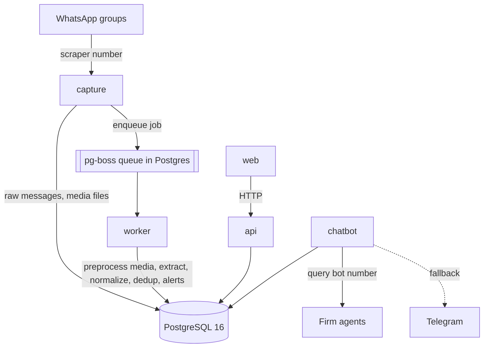
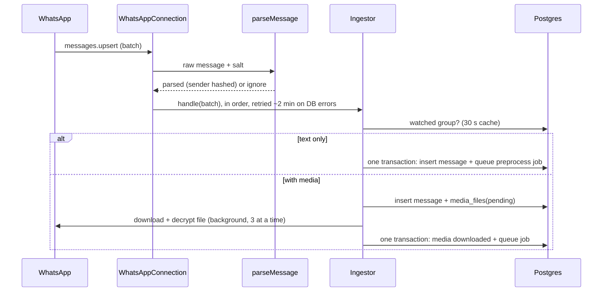
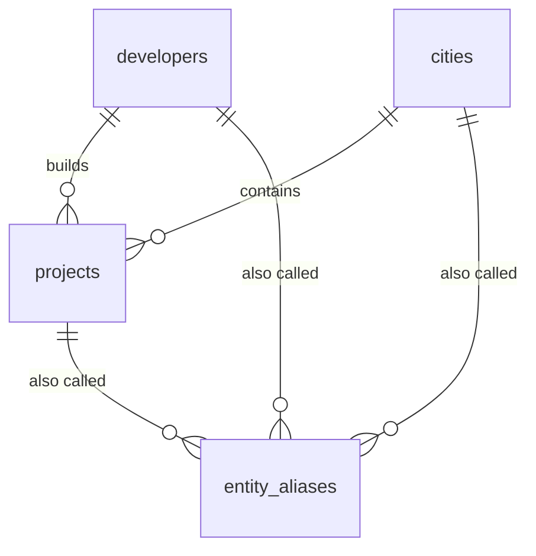
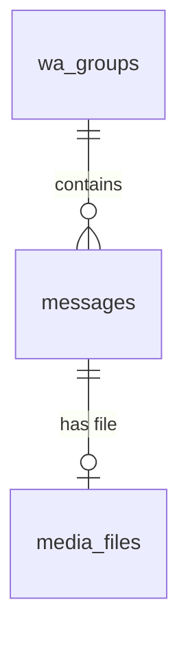
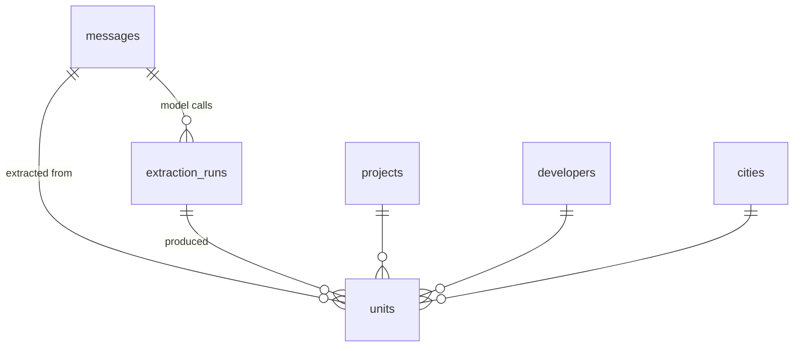
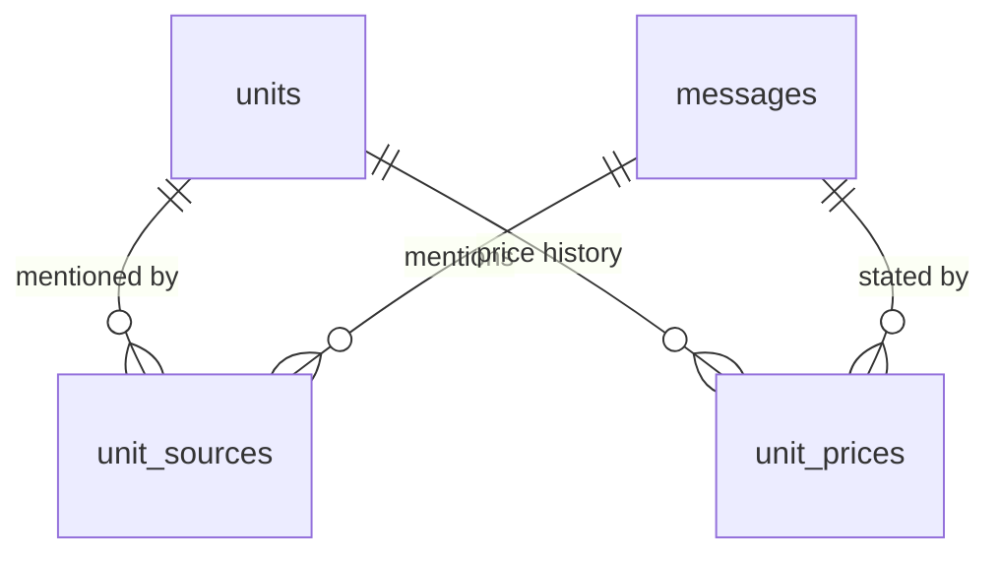

# Real Estate Bot: Project Manual

This is the full technical manual. Together with [README.md](README.md), someone who has never seen the project should be able to understand it, set it up from zero, run it and fix it. Each chapter says what exists **now**. Parts that later phases will build are marked _(Phase N)_.

Reference material that could drift from the code is generated, not hand-written:

- [docs/generated/env.md](docs/generated/env.md): environment variables (from `packages/config/src/env.ts`)
- [docs/generated/database.md](docs/generated/database.md): tables, columns, indexes and entity diagram (from `packages/db/src/schema/`)
- [docs/generated/template.md](docs/generated/template.md): the 26 Primary Units columns and their rules (from `packages/schema/src/columns.ts`)
- [docs/generated/api.md](docs/generated/api.md): every API route with its parameters (from the Fastify route schemas)

Regenerate them with `pnpm run docs`.

[PITCH.md](PITCH.md) is the non-technical counterpart for investors and buyers. It is updated at the end of every phase, alongside this manual, and only claims what is built and tested. CI runs `pnpm docs:check` and fails if they are out of date.

## Build status

| Phase | Scope                                                              | Status                                                           |
| ----- | ------------------------------------------------------------------ | ---------------------------------------------------------------- |
| 0     | Foundation: monorepo, config, logging, Docker, database, seed      | **Done**                                                         |
| 1     | Capture (Baileys, raw messages, media)                             | **Done** (live WhatsApp test waits for the scraper number)       |
| 2     | Text extraction and eval harness                                   | **Built** (accuracy run waits for real cases and a Gemini key)   |
| 3     | Media extraction (vision, PDF; voice notes dropped)                | **Built** (accuracy on real flyers waits for real cases)         |
| 4     | Dedup, price history, lifecycle                                    | **Done** (tolerances to tune on real data)                       |
| 5     | API and owner admin (login, pairing, groups, review, names, stats) | **Done** (pairing from the browser waits for the scraper number) |
| 6     | Multi-tenant firm dashboard                                        | Not started                                                      |
| 7     | Chat bots and alerts                                               | Not started                                                      |
| 8     | Hardening and deploy                                               | Not started                                                      |

**Waiting on Hassan**

- [ ] Scraper WhatsApp number, for the live Phase 1 test (pairing, groups, restart without loss).
- [x] `GEMINI_API_KEY` added to the cloud environment (2026-10-26); add it to `.env` on the server too. `GROQ_API_KEY`, `OPENROUTER_API_KEY` optional fallbacks.
- [ ] 20-50 real listing messages for `eval/cases` (chapter 12).
- [x] ~~The original `primary-units-template.xlsx`~~ Committed in `packages/schema/template/` (2026-10-26); the export matches it.
- [x] ~~Confirm: a lone "من"/"from" before a price means "starting from"~~ Confirmed by Hassan 2026-10-26.
- [x] ~~Phase 3 vision provider~~ Gemini chosen (2026-10-26); images may be sent as they are.

---

## 1. Overview and glossary

Hassan, a broker, runs this as a service. A bot reads Egyptian developer and broker WhatsApp groups and turns every listing into structured, deduplicated records that stay current. Brokerage firms pay for access to that shared listing pool. They get fresher and cleaner data than they would by reading the groups themselves.

**Users.** The **owner** (Hassan) controls everything. Each **firm** has a **firm admin** who manages the firm's users, and **agents** who search, save searches, get alerts and export.

| Term                            | Meaning in the code                                                                                                                            |
| ------------------------------- | ---------------------------------------------------------------------------------------------------------------------------------------------- |
| **Entity**                      | A canonical city, developer or project: one official row per real-world thing (`cities`, `developers`, `projects`).                            |
| **Alias**                       | Another spelling of an entity, in any script (`entity_aliases`). "التجمع", "5th Settlement" and "Tagamoa" are aliases of the city _New Cairo_. |
| **Normalized name**             | The output of `normalizeName()`: lowercase, unified Arabic letters, no diacritics or punctuation. Aliases are matched on this.                 |
| **Seed**                        | The starter list of entities and aliases in `packages/db/seed/`, loaded by `pnpm db:seed`.                                                     |
| **Migration**                   | A numbered SQL file in `packages/db/migrations/` that changes the database structure.                                                          |
| **Unit / offering** _(Phase 2)_ | One row in `units`: a unit type with area and price range in one project, or a single named unit when a Unit Code is given.                    |
| **Source** _(Phase 4)_          | A WhatsApp message that mentioned a unit. One unit can have many sources.                                                                      |
| **Run** _(Phase 2)_             | One LLM extraction attempt on one message (`extraction_runs`), with its prompt version and model.                                              |
| **Prompt version** _(Phase 2)_  | The version string of the extraction prompt, recorded on every run so results can be compared.                                                 |
| **Firm** _(Phase 6)_            | A paying brokerage. Owns its users, saved searches, alerts and notes. Listings are shared.                                                     |
| **Saved search** _(Phase 6)_    | A stored filter that can trigger alerts.                                                                                                       |
| **JID**                         | A WhatsApp address. Groups end in `@g.us`, people in `@s.whatsapp.net` (phone number) or `@lid` (private ID).                                  |
| **LID**                         | WhatsApp's private per-user ID, used in groups instead of the phone number. Preferred for sender hashing.                                      |
| **Sender hash**                 | `messages.sender_hash`: salted HMAC-SHA256 of the sender's ID. Same person → same hash; the number can't be recovered.                         |
| **Watched group**               | A group whose messages capture stores (`wa_groups.watched`). New groups start unwatched.                                                       |
| **Account**                     | A WhatsApp number the system uses: `scraper` (capture) or `query-bot` (Phase 7).                                                               |
| **Job / queue**                 | A unit of pipeline work in pg-boss (e.g. `preprocess` for one message), retried on failure.                                                    |

## 2. Architecture



| Service | Responsibility                                                                                                 | Must never                         |
| ------- | -------------------------------------------------------------------------------------------------------------- | ---------------------------------- |
| capture | Stay connected to WhatsApp, save every message from watched groups with media and reply context, enqueue a job | Call an LLM or do heavy processing |
| worker  | Run all pipeline jobs with retries, backoff and rate limits                                                    | Talk to WhatsApp directly          |
| api     | Auth, firm scoping, search, review, admin actions, exports                                                     | Contain extraction logic           |
| web     | Firm dashboard and owner admin UI                                                                              | Query the database directly        |
| chatbot | Answer listing queries and deliver alerts, Telegram as fallback                                                | Use the scraper's WhatsApp number  |

**Why these choices**

- **Capture and worker are separate.** Capture only saves; it never waits for a model. If a model is slow, down or out of credit, messages still pile up safely in Postgres and are processed later. Old messages can be reprocessed after any prompt or model change.
- **The queue is in Postgres (pg-boss).** No Redis to run, back up or monitor. Jobs, retries and schedules live next to the data and are covered by the same backup.
- **Baileys** talks to WhatsApp over a WebSocket without a headless browser, so it is lighter and easier to deploy than whatsapp-web.js. It is unofficial, so the scraper and query bot use separate numbers and Telegram is the fallback.
- **One shared Zod schema** _(Phase 2)_ defines the listing fields once; database types, LLM JSON schema and API types come from it.
- **The LLM reads; code decides.** The model only pulls raw values out of messy text. All arithmetic, entity matching, currency handling, confidence scoring and merge decisions are deterministic code with tests.
- **Node runs TypeScript directly.** Node 24 strips type annotations at load time, so there is no compile step for the Node services: the code that runs is the code you read. `tsc` is used only as a type checker. The cost: TypeScript-only runtime features (`enum`, `namespace`) are not allowed, which `erasableSyntaxOnly` enforces. Use `as const` objects or Zod enums instead.
- **One Docker image for all services.** Each service is the same image with a different command, so they always share exact code and dependency versions.

**Runtime behaviour.** Every Node service starts through `runService` (`packages/runtime`): load config (refusing to start if a variable that service requires is missing), then logger, then database pool, then `/health`. On SIGTERM it shuts down cleanly. The API is the exception: it has its own Fastify server and serves `/health` on `API_PORT`.

**Capture in one picture (Phase 1)**



## 3. Repository map

```
realestate-bot/
  apps/
    capture/   src/main.ts (wiring), src/cli.ts (groups command)
    worker/    src/main.ts (pipeline jobs), src/cli.ts (reprocess, export)
    api/       src/app.ts, src/admin-routes.ts (owner API), src/auth-routes.ts (login), src/create-owner.ts
    web/       React admin console: src/pages/* (login, overview, WhatsApp, groups, review, names, jobs, settings)
    chatbot/   src/main.ts: skeleton service                          (Phase 7)
  packages/
    config/    env schema (Zod) and loadConfig()
    db/        Drizzle schema, migrations, client, migrate + seed scripts, seed data
    normalize/ normalizeName() and digit conversion
    runtime/   logger, health server, runService()
    queue/     pg-boss setup, job names and payloads, transactional enqueue
    whatsapp/  Baileys connection, Postgres auth store, message parsing, sender hashing
    ingest/    storing messages and media, groups, exactly-once queueing, crash recovery
    schema/    the listing fields (Zod), enums, model JSON schema, template column map, Excel export
    llm/       model client (fallback, rate limits, privacy scrub) and versioned prompts
    pipeline/  preprocess / classify / extract steps, entity matching, dedup/merge, lifecycle, reprocess, export
    dedup/     when two listings are the same unit; which unit a reply means; price changes
    media/     reads text in images (vision), PDFs (text layer, vision for scans) and Excel sheets
    auth/      owner login (Better Auth): sessions, password hashing, create-owner
    admin/     what the admin console does: review, corrections, names, groups, stats, settings, eval cases
  eval/        labeled cases, recordings, scoring, the `pnpm eval` runner and `pnpm eval:from-review`
  scripts/docs.ts           generates docs/generated/* (env, database, template, API) and .env.example
  docs/generated/           generated reference docs (do not edit)
  docker-compose.yml        Postgres + migrate step + five services
  Dockerfile                one image for every service
  .github/workflows/ci.yml  lint, format, types, tests (with real Postgres), docs check, web build
```

| Package          | Owns                                                                                                   | Main files                                                                                 | Used by                            |
| ---------------- | ------------------------------------------------------------------------------------------------------ | ------------------------------------------------------------------------------------------ | ---------------------------------- |
| `@reb/config`    | Environment variables: schema, defaults, validation                                                    | `src/env.ts`, `src/load.ts`                                                                | db, runtime, api, scripts          |
| `@reb/normalize` | Deterministic text normalization                                                                       | `src/text.ts`                                                                              | db (seed) and, later, the pipeline |
| `@reb/db`        | Tables, migrations, pool, seed                                                                         | `src/schema/*`, `migrations/*`, `src/seed.ts`, `seed/*`                                    | runtime, api, scripts              |
| `@reb/runtime`   | Logging, health checks, service lifecycle                                                              | `src/logger.ts`, `src/health.ts`, `src/service.ts`                                         | all Node apps                      |
| `@reb/queue`     | Job queue (pg-boss): queues, payload schemas, retries                                                  | `src/queues.ts`, `src/boss.ts`                                                             | capture, worker, ingest            |
| `@reb/whatsapp`  | WhatsApp connection, login keys, message parsing, sender hashing                                       | `src/connection.ts`, `src/parse.ts`, `src/auth-store.ts`                                   | capture; chatbot (Phase 7)         |
| `@reb/ingest`    | Storing messages and media, group management, queueing                                                 | `src/ingestor.ts`, `src/files.ts`, `src/groups.ts`                                         | capture; api (Phase 5)             |
| `@reb/schema`    | The listing fields, enums, model schema, template columns, Excel export                                | `src/unit.ts`, `src/extraction.ts`, `src/columns.ts`, `src/export.ts`                      | db, normalize, llm, pipeline, eval |
| `@reb/llm`       | Model calls: fallback, rate limits, privacy scrub; prompts                                             | `src/client.ts`, `src/privacy.ts`, `prompts/*.ts`                                          | pipeline, eval                     |
| `@reb/pipeline`  | Processing steps, entity matching, dedup/merge and price history (apply), lifecycle, reprocess, export | `src/steps.ts`, `src/apply.ts`, `src/entities.ts`, `src/admin.ts`                          | worker, eval                       |
| `@reb/dedup`     | Same-unit rules, reply targeting, price-change detection (pure)                                        | `src/match.ts`, `src/prices.ts`                                                            | pipeline                           |
| `@reb/media`     | Text inside images (vision), PDFs (text layer, vision for scans) and Excel sheets                      | `src/describe.ts`, `src/image.ts`, `src/pdf.ts`, `src/sheet.ts`                            | pipeline, eval                     |
| `@reb/auth`      | Owner login: Better Auth setup, sessions, password hashing, creating the owner                         | `src/auth.ts`, `src/owner.ts`                                                              | api                                |
| `@reb/admin`     | Review and corrections, names and spellings, groups, stats, failed jobs, settings, review → eval cases | `src/review.ts`, `src/entities.ts`, `src/stats.ts`, `src/settings.ts`, `src/eval-cases.ts` | api, worker (export rate), eval    |

Packages planned for later phases and not created yet: `chat-core` (Phase 7).

**Dependency direction:** `apps → (runtime, ingest, pipeline, admin, auth) → (whatsapp, queue, llm, media, dedup, normalize, schema) → db → (config, normalize, schema)`. `schema` depends on nothing of ours. Packages never import from apps.

**Library versions** (checked 2026-10-25):

| Library                                      | Version                          | Note                                                                   |
| -------------------------------------------- | -------------------------------- | ---------------------------------------------------------------------- |
| Node.js                                      | 24 LTS (Docker), ≥ 22.18 locally | 22.18+ runs TypeScript without flags                                   |
| pnpm                                         | 12.15.0                          |                                                                        |
| TypeScript                                   | 6.0.3                            | 7.0 exists but typescript-eslint supports < 6.1                        |
| drizzle-orm / drizzle-kit                    | 0.45.4 / 0.31.11                 | latest stable; 1.0 is still beta                                       |
| pg (node-postgres)                           | 8.23.1                           |                                                                        |
| zod                                          | 4.6.7                            |                                                                        |
| pino                                         | 10.4.0                           |                                                                        |
| fastify                                      | 5.12.7                           |                                                                        |
| vite / react                                 | 8.3.5 / 19.3.1                   |                                                                        |
| vitest                                       | 5.0.5                            |                                                                        |
| eslint / typescript-eslint / prettier        | 10.13.0 / 8.72.0 / 3.9.10        |                                                                        |
| pg-boss                                      | 12.38.0                          |                                                                        |
| baileys                                      | 7.0.0-rc14                       | npm's `latest` tag; the 6.x line is marked `legacy`. See decision log. |
| qrcode                                       | 1.5.4                            | Pairing QR code in the logs and, as an image, in the admin console     |
| grammY                                       | 1.46.0                           | Phase 7                                                                |
| better-auth                                  | 1.7.13                           | Owner login                                                            |
| @fastify/swagger / fastify-type-provider-zod | 9.9.2 / 7.0.0                    | Route schemas from Zod; the API reference is generated from them       |
| react-router / @tanstack/react-query         | 8.4.0 / 5.104.1                  | Admin console                                                          |
| tailwindcss                                  | 4.3.3                            | Admin console styling (hand-written components, no UI library)         |
| exceljs                                      | 4.4.0                            | Excel export                                                           |

## 4. Data model

The full generated reference, with every column and an entity diagram, is in [docs/generated/database.md](docs/generated/database.md).

**Canonical entities (Phase 0)**



- `cities`, `developers`: an English name (unique, used in exports) and an Arabic name.
- `projects`: belong to one developer and one city. The English name is unique per developer.
- `entity_aliases`: every known spelling. Exactly one of `city_id`, `developer_id`, `project_id` is set (a CHECK constraint enforces it). The same normalized spelling cannot point at the same entity twice, but it may name a city _and_ a project (for example "Madinaty").
- Deleting a city or developer that still has projects is refused (`ON DELETE RESTRICT`). Deleting an entity deletes its aliases (`ON DELETE CASCADE`).
- IDs are small integers (identity columns) because these tables are small and you will read and type these IDs by hand.

**How names are matched.** Both the stored alias and the incoming text go through `normalizeName()` (chapter 6), then:

1. exact match on `alias_normalized` (index), and if nothing is found
2. fuzzy match with pg_trgm: `alias_normalized % $1 ORDER BY similarity(...) DESC` (GIN trigram index).

The matching function itself arrives with extraction in Phase 2. The table and indexes are ready.

**Capture tables (Phase 1)**



- `wa_groups`: every group the scraper number is in. `watched` (default false) decides whether messages are stored; `source_type` is developer or broker; `is_member` turns false when the number leaves.
- `messages`: one row per stored message, unique per (group, WhatsApp ID). Holds the text or caption, `sender_hash`, `quoted_wa_message_id` (reply context), `edit_of_wa_message_id` (edits are new rows), `deleted_at` ("delete for everyone"), `is_forwarded`, and processing fields: `status` (`pending` → `processing` → `processed` / `skipped` / `failed`), `error`, `attempts`, `enqueued_at`.
- `media_files`: at most one per message. `status`: `pending` → `downloaded`, or `failed` (5 attempts) / `skipped` (over the size limit). `sha256` and `path` (content-addressed under MEDIA_DIR). `media_ref` lets the file be downloaded again. From Phase 3: `derived_text` (the text found in the file), `derived_method` (`vision`, `pdf`, `spreadsheet`, `skipped`, `failed`), `derived_at` and `derived_error`.
- `wa_auth`: WhatsApp login keys per account. **Treat as a secret**: whoever has these rows can act as the number.
- `wa_connections`: live status per account (`state`, QR/pairing code while pairing, last connect/disconnect and reason, last message time).
- Status and type columns have CHECK constraints, so the database rejects unknown values.

**Tables added by later phases:** `review_corrections`, `audit_log` (Phase 5); `firms`, `users`, `chat_identities`, `saved_searches`, `firm_notes`, `usage_events` (Phase 6); `alert_deliveries` (Phase 7). Each arrives as its own migration in the phase that uses it.

**Listing tables (Phase 2)**



- `units`: one row per unit offering. The 26 template columns in template order, then internal columns: `status`, `price_currency`, `down_payment_amount`, `installment_years`, `installment_frequency`, `ready_to_move`, `confidence`, `needs_review`, `review_reasons`, `extras` (unmatched names), `source_message_id`, `extraction_run_id`, `first_seen_at`, `last_seen_at`. Every allowed value is enforced by a CHECK constraint generated from `@reb/schema`.
- `extraction_runs`: every model call, kept forever (reprocessing adds rows, never deletes): purpose (`classify`/`extract`), prompt version, provider, model, the request as sent, the raw answer, the parsed answer, tokens, cost, latency, status.
  **Dedup and price history (Phase 4)**



- One unit per real offering. `unit_sources` links it to every message that mentioned it, with a role: `listing` (posted or reposted), `price_update`, `sold`.
- `unit_prices` is the price history: one row for the first price, then one each time the price or payment terms change. A repost with the same terms adds a source, not a price row. The unit's own price columns always hold the most recent observation.
- `units.first_seen_at` / `last_seen_at` are the earliest and latest source messages.

**Unit statuses**

| Status      | Meaning                                                    | Set by                                                |
| ----------- | ---------------------------------------------------------- | ----------------------------------------------------- |
| `active`    | Currently on offer                                         | New listing; a repost or price update of a stale unit |
| `stale`     | Not posted or updated for `STALE_AFTER_DAYS` (45) days     | Daily lifecycle job (03:17 Cairo time)                |
| `sold`      | A sold notice said so (`sold_by_message_id` records which) | Sold reply or matching sold notice                    |
| `withdrawn` | Taken off the market                                       | Owner, from the admin page (Phase 5)                  |

Stale and sold units are kept, with their history; exports include only `active` units unless `--all` is given.

**Primary Units template mapping:** generated from the column map in `packages/schema`: **[docs/generated/template.md](docs/generated/template.md)** (header, database column and rule for all 26 columns). The export writes exactly those headers in that order (tests compare the headers and sheet name with Hassan's original file in `packages/schema/template/`).

**Template rules agreed with Hassan (2026-10-25)**, implemented in Phase 2:

| Question                              | Decision                                                                                                                                                                                                                                 |
| ------------------------------------- | ---------------------------------------------------------------------------------------------------------------------------------------------------------------------------------------------------------------------------------------- |
| Category values                       | `Residential`, `Commercial`, `Administrative`, `Medical`                                                                                                                                                                                 |
| Down Payment                          | Stored both ways: the template column is a **percent (0–100)**; when a message states an amount, the amount is also kept internally, and the percent is computed in code when the price is known                                         |
| Maintenance Currency                  | `EGP`, `USD` or `%` (percent of the price)                                                                                                                                                                                               |
| Price currency                        | **EGP is the main currency.** Prices are stored in their original currency; the export converts USD prices to EGP using **one exchange rate the owner sets** (a setting, updated by hand). The original USD price stays in the database. |
| Delivery Year for ready-to-move units | **Blank**, with "Ready to move" written in Notes; the internal `ready_to_move` flag is set                                                                                                                                               |
| Row granularity                       | **One row per unit type** (with Min/Max ranges); a message naming a specific unit (Unit Code) gets its own row                                                                                                                           |

**Money** is stored as integers in minor units (piastres / cents) with `price_currency`: `min_price = 650000000, price_currency = 'EGP'` is EGP 6,500,000. Prices are stored in the currency they were stated in; the Excel export converts USD to EGP with the owner-set `USD_EGP_RATE`.

## 5. Pipeline

Each step is its own pg-boss job type, idempotent, with retries and backoff. Jobs carry only IDs and read everything else from the database.

**Step 1: capture (Phase 1, in the capture service, not a job)**

|             |                                                                                                                                                                                            |
| ----------- | ------------------------------------------------------------------------------------------------------------------------------------------------------------------------------------------ |
| Input       | WhatsApp `messages.upsert` events from the scraper number                                                                                                                                  |
| Output      | `messages` row (+ `media_files` row and file on disk), then one `preprocess` job                                                                                                           |
| Ignored     | Unwatched groups, private chats, status updates, own messages, stickers, reactions, polls, system notices                                                                                  |
| Idempotency | Unique (group, WhatsApp ID) → a redelivered message is skipped. `enqueued_at` is set in the same transaction as the job, only if empty → exactly one job per message.                      |
| Retries     | Storing a batch: about 2 minutes (database outage). Media download: up to 5 attempts, swept every 5 minutes; then the message is queued without the file.                                  |
| Restart     | Messages that arrived while capture was down are delivered by WhatsApp on reconnect. On start, a sweep finishes interrupted downloads and queues anything never queued.                    |
| Known gap   | WhatsApp acknowledges a message before we store it. If the database is down for more than ~2 minutes while messages arrive, those messages are lost (their IDs are logged at error level). |

**Job: `preprocess`** (step 2, routing)

|         |                                                                                                                                                                                                                                                                                                                                                                                           |
| ------- | ----------------------------------------------------------------------------------------------------------------------------------------------------------------------------------------------------------------------------------------------------------------------------------------------------------------------------------------------------------------------------------------- |
| Payload | `{ messageId }`                                                                                                                                                                                                                                                                                                                                                                           |
| Does    | Images and documents → `transcribe`. Voice notes and videos → only their caption is read ("Voice notes are not processed" / "Videos are not processed" when there is none). A text the same sender posted within `CAPTION_WINDOW_SECONDS` (2 min) of an image or file → `skipped` ("Caption of message N; read together with it"). Other text → `classify`. Deleted or empty → `skipped`. |
| Retries | 8, exponential backoff from 30 s                                                                                                                                                                                                                                                                                                                                                          |

**Job: `transcribe`** (Phase 3, step 2 for files)

|         |                                                                                                                                                                                                                                                                                                                                                                                                                                                                                                                    |
| ------- | ------------------------------------------------------------------------------------------------------------------------------------------------------------------------------------------------------------------------------------------------------------------------------------------------------------------------------------------------------------------------------------------------------------------------------------------------------------------------------------------------------------------ |
| Payload | `{ messageId }`                                                                                                                                                                                                                                                                                                                                                                                                                                                                                                    |
| Does    | Reads the file from `MEDIA_DIR` and saves its text on `media_files.derived_text`: images by vision, PDFs by their text layer (vision only for pages without text, up to `PDF_MAX_PAGES`), Excel by its cells. Each vision call is an `extraction_runs` row (`purpose = transcribe`, `media_file_id`) with tokens, cost and latency. Then queues `classify`, **delayed until the caption window has passed**, so a caption sent after the flyer is included. A file that never downloaded goes on with its caption. |
| Retries | 4, backoff from 2 min. On the **last** attempt a file that still can't be read goes on with its caption instead of being lost.                                                                                                                                                                                                                                                                                                                                                                                     |
| Context | The model then reads: the caption, `[Text in the attached file]` + the transcription, and `[Same sender, posted right before or after]` + nearby texts. Replies under a flyer see the flyer's text too.                                                                                                                                                                                                                                                                                                            |

**Job: `classify`** (Phase 2, step 4)

|         |                                                                                                                                                                                                                                                                                                      |
| ------- | ---------------------------------------------------------------------------------------------------------------------------------------------------------------------------------------------------------------------------------------------------------------------------------------------------- |
| Payload | `{ messageId }`                                                                                                                                                                                                                                                                                      |
| Does    | Builds the context (message + the message it replies to, contact details scrubbed). Free keyword check first: no listing words → `skipped` without calling a model. Otherwise one model call → `listing`, `price_update`, `sold` or `not_relevant`. Not relevant → `skipped`; else queues `extract`. |
| Retries | 6, backoff from 60 s. A failure means every model in the fallback list failed: the message is marked `failed` with the reason until a retry succeeds.                                                                                                                                                |

**Job: `extract`** (Phase 2, steps 5-6)

|             |                                                                                                                                                                                                                                                                                                      |
| ----------- | ---------------------------------------------------------------------------------------------------------------------------------------------------------------------------------------------------------------------------------------------------------------------------------------------------- |
| Payload     | `{ messageId, intent }`                                                                                                                                                                                                                                                                              |
| Does        | One model call returns raw phrases per unit; code matches names and normalizes every field (chapter 6). Listings: the message's units are replaced in one transaction. Price updates and sold notices: kept in `extraction_runs` for Phase 4. Message → `processed` (or `skipped` "No units found"). |
| Idempotency | Re-running replaces this message's units; model calls are always added, never replaced.                                                                                                                                                                                                              |
| Retries     | 6, backoff from 60 s                                                                                                                                                                                                                                                                                 |

All waiting jobs are kept 60 days. **Without a model API key** the worker logs a warning and does not start `classify`/`extract`: messages wait in the queue until a key is added and the worker restarts.

**Reprocessing** (after a prompt or model change, or when Phase 3 adds media):

```sh
docker compose exec worker node apps/worker/src/cli.ts reprocess --status skipped
docker compose exec worker node apps/worker/src/cli.ts reprocess --from 2026-10-01 --to 2026-11-01
docker compose exec worker node apps/worker/src/cli.ts reprocess --group 3
docker compose exec worker node apps/worker/src/cli.ts reprocess --message 120,121
```

Matching messages go back to `pending` and through every step again with the current prompts and models. Old model calls stay in `extraction_runs` for comparison.

**Steps 7-8: dedup, price history, sold** (inside the `extract` job, one transaction, one advisory lock so simultaneous reposts can't create twins)

- **Listing:** for each unit, find an `active` or `stale` unit that matches (chapter 6). Match: add a source, fill in details the unit lacked, add a price row if the terms changed, `stale` → `active`. No match: create a unit with its first source and price row. Two units in one message never merge into the same existing unit.
- **Price update:** if it replies to (or edits) an earlier message, the target is among that message's units: the only one, or the one the update names (type, bedrooms, area). If it can't tell which, nothing changes and the units are flagged for review. Without a reply, the matching rules find the unit. The new terms are merged into the current ones (unstated terms are kept) and a price row is added.
- **Sold:** same targeting; the unit becomes `sold`. Reprocessing the notice undoes and reapplies it.

**Job: `lifecycle`** (daily, 03:17 Cairo time): `active` units whose `last_seen_at` is older than `STALE_AFTER_DAYS` become `stale`. Retries 3.

_(Phase 7)_ alerts.

## 6. Extraction

**The split (build plan, section 7).** The model reads messy text and copies phrases; code does everything deterministic.

| The model (Gemini, then Groq, then OpenRouter)                                        | Code (`@reb/normalize`, `@reb/pipeline`)                                  |
| ------------------------------------------------------------------------------------- | ------------------------------------------------------------------------- |
| Says what a message is about (classify)                                               | Free keyword check before calling it                                      |
| Returns one entry per unit type, with phrases copied as written ("يبدأ من 6.5 مليون") | Turns phrases into numbers, currencies, years, counts                     |
| Chooses unit type, finishing, category from fixed lists                               | Matches names to canonical entities; infers category from unit type       |
| Quotes the evidence for project, unit type, area, price                               | Checks every value and quote really appears in the message (no invention) |
| Writes a short English note                                                           | Computes confidence and review reasons                                    |

**Prompts and versions.** `packages/llm/prompts/classify.ts` and `extract.ts`, each with a `VERSION` (currently `classify-2026-10-26.1`, `extract-2026-10-26.1`). Every `extraction_runs` row records it. To change a prompt: edit it, bump `VERSION`, run `pnpm eval`, compare with the previous report, and get approval if a key field drops by more than 2 points (chapter 12).

**Models and fallback.** Set in `.env` as `provider:model` lists in fallback order:

- Classification: `LLM_CLASSIFY_MODELS`, default `gemini:gemini-flash-lite-latest,groq:openai/gpt-oss-120b,openrouter:openrouter/free`
- Extraction: `LLM_EXTRACT_MODELS`, default `gemini:gemini-flash-latest,groq:openai/gpt-oss-120b,openrouter:openrouter/free`

| Order | Provider                                                                                 | Key                                    | Why                                                                                                                                                                                                    |
| ----- | ---------------------------------------------------------------------------------------- | -------------------------------------- | ------------------------------------------------------------------------------------------------------------------------------------------------------------------------------------------------------ |
| 1     | Google Gemini (`gemini-flash-lite-latest` to classify, `gemini-flash-latest` to extract) | `GEMINI_API_KEY` (aistudio.google.com) | Free tier, good Arabic, full JSON Schema support; likely also the vision model in Phase 3. The `-latest` names are Google's aliases for the current Flash models, so model retirements need no change. |
| 2     | Groq (`openai/gpt-oss-120b`)                                                             | `GROQ_API_KEY` (console.groq.com)      | Free tier, a different company, very fast. Users report it sometimes ignores the schema; our validation turns that into a retry or the next model.                                                     |
| 3     | OpenRouter (`openrouter/free`)                                                           | `OPENROUTER_API_KEY` (openrouter.ai)   | Free router across many models; sent with `require_parameters: true` so it only picks models that honour the JSON schema. About 50 free requests a day (1,000 after a one-time $10 top-up).            |
| (off) | Cerebras                                                                                 | `CEREBRAS_API_KEY`                     | Paid since late October 2026; add `cerebras:gpt-oss-120b` to a list to use it.                                                                                                                         |

A model whose provider has no key is skipped, so any one key is enough to run.

Requests use `response_format: json_schema, strict: true`. A rate limit, timeout, server error or refusal moves to the next model; an answer that fails validation gets one retry on the same model with the error appended. Each model has its own requests-per-minute limit (`LLM_REQUESTS_PER_MINUTE`, default 10); classification and extraction use different Gemini models so they don't share one limit. The client waits for a free slot instead of failing; a daily quota error (429) moves on to the next provider.

**Normalization rules** (each has tests in `packages/normalize/test`):

| Rule                     | Examples                                                                                                                                                    |
| ------------------------ | ----------------------------------------------------------------------------------------------------------------------------------------------------------- |
| Numbers                  | `٣٫٥` → 3.5 · `1,250,000` / `1.250.000` → 1250000 · `3,5` → 3.5                                                                                             |
| Multipliers (money only) | `3.5 مليون`, `3.5M` → 3,500,000 · `850 ألف`, `850k` → 850,000 · `6.500 مليون` → 6,500,000                                                                   |
| Halves, words, compounds | `مليون ونص` → 1.5M · `نص مليون` → 500k · `مليونين` → 2M · `تلاتة مليون` → 3M · `9 مليون و 200 ألف` → 9.2M                                                   |
| Ranges                   | `6.5 - 9 مليون` → 6.5M–9M (the multiplier applies to both) · `من 120 ل 180` → 120–180                                                                       |
| Starting from            | `يبدأ من 6.5 مليون`, `starting from`, a lone `من` → Min only, Max empty                                                                                     |
| Single value             | `150 متر` → Min = Max = 150                                                                                                                                 |
| Bare price               | `السعر 6.5` (no million/thousand) → read as 6.5 million and flagged for review                                                                              |
| Areas                    | `m` means metres, not million: `BUA 320 m` → 320. Areas outside 10–100,000 m² are dropped.                                                                  |
| Currency                 | `$`, `USD`, `dollar`, `دولار` → USD, otherwise EGP                                                                                                          |
| Delivery                 | `Q3 2027` → 2027 · `Q4-28` → 2028 · `بعد 3 سنين` → message year + 3 · `استلام فوري`, `RTM`, `جاهز` → ready to move, year blank · two years → first, flagged |
| Installments             | `8 years quarterly` / `على 8 سنين ربع سنوي` → 8 × 4 = 32 · `96 شهر` → 96 monthly · `على 7 سنين` → 7 years, count unknown                                    |
| Percent or amount        | `10%`, `١٠٪`, `10 في المية` → percent · `مقدم 500 ألف` → amount (down payment percent then computed from the price)                                         |
| Floor                    | `أرضي` → Ground · `روف` → Roof · `الدور التالت`, `3rd floor` → 3 · `1-5` → 1-5                                                                              |
| Rooms                    | `3 غرف`, `3BR`, `تلات غرف` → 3 · `غرفتين` → 2 · `3+1` → 3                                                                                                   |

**No invention.** Every value the model returns for a copied field (names, areas, price, delivery, payment terms...) must appear in the message (compared ignoring spacing, punctuation, diacritics and digit style). If not, it is dropped and the unit is flagged: `Dropped price "12 مليون": not found in the message`. Evidence quotes are checked the same way.

**Entity matching** (`packages/pipeline/src/entities.ts`), for developer, project and city separately:

1. exact normalized alias (`MIVIDA`, `ميفيدا` → Mivida);
2. a known alias contained as whole words, longest first (`ميفيدا التجمع` → Mivida); aliases of 3 characters or fewer only match exactly;
3. fuzzy trigram similarity ≥ 0.40 (`mivda` → Mivida, 0.44), always flagged for review.

A matched project fills in its developer and city; if the message names a different developer or city, the project's wins and the conflict is flagged. Unknown names are kept in `extras.unmatched` and flagged.

**Confidence (0-1) and review.** Confidence = 0.25 × project match + 0.15 × developer (or city) + 0.15 × unit type + 0.25 × price (0.6 if the million/thousand was assumed) + 0.20 × area. A unit needs review if confidence < 0.7 or any reason was recorded: no price, no area, no unit type, dropped value, bad evidence, fuzzy or unknown name, USD price, price per m² outside 3,000-1,000,000 EGP, ambiguous delivery, out-of-range down payment.

**Cost per message.** Each message costs 0, 1 or 2 model calls (keyword filter, classification, extraction). On the free tier cost is recorded as 0 (`LLM_FREE_TIER=true`); tokens and latency are always recorded. Daily cost and call counts: `select date(created_at), purpose, count(*), sum(input_tokens), sum(output_tokens), sum(cost_usd) from extraction_runs group by 1, 2 order by 1;`

**Dedup algorithm** (`packages/dedup`). Two listings are the same unit when all of these hold:

1. same project (listings without a known project are never merged);
2. same developer, when both are known;
3. same unit type;
4. unit codes: a named unit only matches the same code, and never matches a unit-type offering;
5. same bedrooms, when both are known;
6. close areas: the gap between the two area ranges is at most 5% of the larger area (`DEDUP_AREA_TOLERANCE_PERCENT`), or 3 m² (`DEDUP_AREA_TOLERANCE_M2`), whichever is bigger. If neither states an area, prices must be within 10% (`DEDUP_PRICE_TOLERANCE_PERCENT`). If only one states an area: different.

Among several matches, the closest area wins. When unsure, the rules say "different": a missed duplicate shows twice and can be merged in review, but a wrong merge loses a real unit.

**Worked examples** (all in the tests):

| Existing unit                        | New post                                       | Result                         | Why                                         |
| ------------------------------------ | ---------------------------------------------- | ------------------------------ | ------------------------------------------- |
| Mivida, Apartment, 3BR, 150 m², 9.5M | Same, in another group                         | Merged: 2 sources, 1 price row | Identical                                   |
| Mivida, Apartment, 3BR, 150 m²       | Mivida, Apartment, bedrooms not stated, 152 m² | Merged                         | Gap 2 m² ≤ 7.6 m²; unknown bedrooms allowed |
| Mivida, Apartment, 3BR, 150 m²       | Mivida, Apartment, 3BR, 157 m²                 | Merged                         | Gap 7 ≤ 5% of 157 (7.85)                    |
| Mivida, Apartment, 3BR, 150 m²       | Mivida, Apartment, 3BR, 158 m²                 | New unit                       | Gap 8 > 7.9                                 |
| Mivida, Apartment, 3BR, 150 m²       | Mivida, Apartment, 3BR, 120-180 m²             | Merged                         | Ranges overlap                              |
| Mivida, Apartment, 3BR, 150 m²       | Mivida, Apartment, **2BR**, 150 m²             | New unit                       | Bedrooms differ                             |
| Mivida, Apartment, 3BR, 150 m²       | Mivida, **Duplex**, 150 m²                     | New unit                       | Type differs                                |
| Mivida, Apartment, 150 m²            | Mivida, Apartment, unit **B12-305**            | New unit                       | Named unit vs offering                      |
| Studio 40 m²                         | Studio 43 m² / 44 m²                           | Merged / new                   | 3 m² minimum applies                        |
| Mivida Apartment 3BR, no area, 9.5M  | Same, no area, 10M                             | Merged                         | No areas: prices within 10%                 |
| Mivida, Apartment, 3BR, 150 m², 9.5M | Same unit at **9.9M**                          | Merged, new price row          | Terms changed                               |
| Listing "2BR 120 m² + 3BR 150 m²"    | Reply "السعر بقى 8 مليون"                      | No change, both flagged        | Can't tell which unit                       |
| Listing "2BR 120 m² + 3BR 150 m²"    | Reply "الـ3 غرف بقت 8 مليون"                   | 3BR gets a price row           | The reply names the unit                    |
| Listing (one unit)                   | Reply "تم البيع"                               | Unit `sold`                    | Only one unit                               |

**Vision (Phase 3).** Images and scanned PDF pages are transcribed by `LLM_VISION_MODELS` (default `gemini:gemini-flash-latest,gemini:gemini-flash-lite-latest`; the two have separate free quotas) with the prompt in `packages/llm/prompts/transcribe.ts` (`transcribe-2026-10-26.1`): copy all text and tables exactly, one table row per line with `|` between cells, `[unreadable]` for illegible parts, `[no text]` for images without text. The transcription then goes through the same extraction, no-invention check and parsing as text. Images are sent as they are (approved by Hassan); photos larger than 2,000 px are scaled down. Text PDFs and Excel sheets need no model call. Details: `packages/media/README.md`.

## 7. Interfaces

**Admin console (Phase 5)** at `PUBLIC_URL` (http://localhost:4173 by default). The owner signs in with e-mail and password; there is no public sign-up.

| Page              | What it does                                                                                                                                                                                                                    |
| ----------------- | ------------------------------------------------------------------------------------------------------------------------------------------------------------------------------------------------------------------------------- |
| Overview          | Messages per day, how many were read successfully, model calls and cost, units waiting for review, units by status                                                                                                              |
| WhatsApp          | Connection state of each number; the pairing QR code (or pairing code) while waiting, refreshed every 3 seconds                                                                                                                 |
| Groups            | Every group the scraper number is in: watch / stop watching, who posts there (developer or brokers), messages saved, last message                                                                                               |
| Review            | Flagged units one at a time: the original message, flyer or PDF and the text read from it on the left; every field of the unit on the right. Save, approve (saves too) or "Not a listing". Every change is kept as a correction |
| Places & names    | Projects, developers and areas with all their spellings: add or remove spellings, rename, add new ones, merge a duplicate into the right one                                                                                    |
| Failed jobs       | Pipeline steps that failed all automatic retries, with the error and a Retry button                                                                                                                                             |
| Settings & export | The USD→EGP rate; download the Primary Units Excel                                                                                                                                                                              |

**API.** Every route, with parameters, is listed in [docs/generated/api.md](docs/generated/api.md) (generated from the route schemas). In short: `GET /health`; `/api/auth/*` (Better Auth: sign in, sign out, session); `/api/admin/*` (owner only: me, whatsapp, groups, review, units, media, entities, aliases, stats, jobs, settings, export.xlsx). The browser only talks to the web address; the web server passes `/api` on to the API (`API_URL`), so the login cookie belongs to one address and no cross-site requests are needed.

Rules every admin route follows: a signed-in **owner** session is required (401 otherwise, 403 for other roles); a change sent from a page that isn't `PUBLIC_URL` is refused (403); every change is written to `audit_log` with who, what and the IP address; input is checked against the same Zod schema as the pipeline, so a correction can't store an impossible value.

Capture, worker and chatbot each serve the same `GET /health` on `HEALTH_PORT` (8080 inside Docker; not published to the host). Capture's includes a `whatsapp` check, which fails once the connection has been down for more than 5 minutes (waiting for pairing counts as healthy).

**Groups command (Phase 1; the Groups page does the same)**

```sh
docker compose exec capture node apps/capture/src/cli.ts groups list
docker compose exec capture node apps/capture/src/cli.ts groups watch <id|jid> [...]
docker compose exec capture node apps/capture/src/cli.ts groups unwatch <id|jid> [...]
docker compose exec capture node apps/capture/src/cli.ts groups source <developer|broker|none> <id|jid> [...]
```

`list` shows id, name, watched, source type, membership, last message time and JID. Changes reach a running capture within 30 seconds.

**Worker command line (Phase 2)**

```sh
docker compose exec worker node apps/worker/src/cli.ts reprocess [--from YYYY-MM-DD] [--to YYYY-MM-DD] [--group <id>] [--status skipped,failed] [--message <id,...>]
docker compose exec worker node apps/worker/src/cli.ts export --out /tmp/units.xlsx [--usd-egp-rate 50] [--message <id,...>] [--all]
docker compose cp worker:/tmp/units.xlsx ./units.xlsx
```

`export` writes active units (all units with `--all`) in the Primary Units template layout. USD prices are converted with `--usd-egp-rate`, else the rate saved on the Settings page, else `USD_EGP_RATE`; without a rate, an export containing USD units stops with an error. Locally: `pnpm --filter @reb/worker pipeline export --out units.xlsx`.

**Owner commands (Phase 5)**

```sh
docker compose exec -it api node apps/api/src/create-owner.ts --email you@example.com --name Hassan   # type the password twice
pnpm eval:from-review          # reviewed messages → eval/cases/review-message-<id>/ (on your machine)
```

Running `create-owner` again for the same e-mail resets the password.

_(Phase 6)_ Firm dashboard. _(Phase 7)_ Chat bot commands with sample Arabic and English queries.

## 8. Configuration

Every variable, with purpose, whether it is required, its default and an example: **[docs/generated/env.md](docs/generated/env.md)**. `.env.example` is generated from the same source.

How it works:

- Services read variables once at startup through `loadConfig()` (`packages/config`). A missing or invalid value stops the service with a message naming the variable.
- When running on your machine, `pnpm db:migrate`, `pnpm db:seed` and `pnpm dev:*` load the root `.env` automatically (Node's `--env-file-if-exists`).
- Inside Docker Compose, `DATABASE_URL` is built from `POSTGRES_USER`, `POSTGRES_PASSWORD` and `POSTGRES_DB` with host `postgres`; the `DATABASE_URL` in `.env` is for running tools on your own machine (host `localhost`).
- `.env` is never committed (`.gitignore`). Secrets only live in environment variables.

## 9. Setting up from zero

Steps marked _(Phase N)_ are not possible yet.

**1. Prerequisites.** A Linux machine or Mac with:

- Docker Engine with the Compose plugin (`docker compose version` works)
- Git
- For development only: Node.js 24 (`nvm install 24`) and pnpm 12 (`npm install -g pnpm@12.15.0`)

**2. Two dedicated WhatsApp numbers** _(needed from Phase 1)_: one for the scraper, one for the query bot. Never Hassan's personal number.

**3. Clone**

```sh
git clone <repo-url> realestate-bot
cd realestate-bot
```

**4. Create `.env`**

```sh
cp .env.example .env
```

Edit `.env`:

- `POSTGRES_PASSWORD`: a long random value (`openssl rand -hex 24` makes one). Put the same password in `DATABASE_URL`. It is only applied the first time the database volume is created (see runbook "Database password rejected").
- `SENDER_HASH_SALT`: the output of `openssl rand -hex 32`. **Never change it later**: the same sender would get a different hash. Keep a copy with your other secrets.
- `AUTH_SECRET`: another `openssl rand -hex 32`. It signs login sessions; changing it signs everyone out.
- `PUBLIC_URL`: the address you open the admin console at. Leave `http://localhost:4173` on your own machine; on the server it becomes the `https://` address (Phase 8).
- `WA_PAIRING_PHONE` (optional): the scraper's own number, digits only (e.g. `201001234567`), if you prefer typing an 8-character code over scanning a QR code.

**5. Start everything**

```sh
docker compose up -d --build
```

This builds one image, starts Postgres, runs the `migrate` step (migrations, then seed), then starts capture, worker, api, chatbot and web. The first build takes a few minutes.

**6. Confirm it works**

```sh
docker compose ps
```

Expected: `postgres`, `capture`, `worker`, `api`, `chatbot`, `web` show `Up ... (healthy)` within about a minute; `migrate` shows `Exited (0)`.

```sh
docker compose logs migrate
# Migrations applied.
# Seed loaded: 17 cities, 20 developers, 57 projects, 360 new aliases.
curl http://localhost:3000/health
# {"status":"ok","service":"api","checks":{"database":"ok"}}
```

To look at the data:

```sh
docker compose exec postgres psql -U reb -d reb -c "select name_en, name_ar from cities"
```

**7. Development setup (optional)**

```sh
pnpm install
pnpm check        # lint, formatting, type check, tests, generated-docs check
```

To include the database integration tests, point them at the running Postgres (the user must be allowed to create databases; the Compose user is):

```sh
TEST_DATABASE_URL=postgres://reb:<password>@localhost:5432/reb pnpm test
```

**8. Create your admin login**

```sh
docker compose exec -it api node apps/api/src/create-owner.ts --email you@example.com --name Hassan
```

Type a password of at least 10 characters (twice; nothing shows while typing). Then open http://localhost:4173 and sign in. On a server, reach it through an SSH tunnel until Phase 8 adds HTTPS: `ssh -L 4173:localhost:4173 you@server`, then open http://localhost:4173 on your own computer.

**9. Pair the scraper number** (from the browser)

The server needs outbound access to `web.whatsapp.com` and `*.whatsapp.net` (normal on a VPS).

Open **WhatsApp** in the admin console. A QR code appears within a few seconds and refreshes by itself. On the scraper phone: WhatsApp → Settings → Linked devices → Link a device → scan. If `WA_PAIRING_PHONE` is set, an 8-character code is shown instead: Link a device → _Link with phone number instead_ → type the code. The badge turns **Connected**.

(Without the browser: `docker compose logs -f capture` prints the same QR code.) The login is saved in the database; restarts don't need pairing again.

**10. Choose groups** (from the browser)

Open **Groups**, tick the groups to watch and set who posts in each (developer or brokers). Within 30 seconds new messages from them are stored, and the message count goes up. (The command line still works: chapter 7.)

**11. Turn on extraction (Gemini, Groq, OpenRouter)**

1. Create API keys (all have free tiers): Gemini at aistudio.google.com → Get API key; Groq at console.groq.com → API Keys; OpenRouter at openrouter.ai → Keys. Gemini alone is enough to start; the other two are fallbacks.
2. Add them to `.env`: `GEMINI_API_KEY=...`, `GROQ_API_KEY=...`, `OPENROUTER_API_KEY=...` (never commit or paste them anywhere else).
3. Set the exchange rate for exports on the **Settings & export** page (or `USD_EGP_RATE=50` in `.env` as a fallback).
4. `docker compose up -d` (restarts the worker with the key). Expected log: `Pipeline ready`.
5. Messages stored earlier without a key are already waiting in the queue and are processed now.

**12. Confirm a message flows end to end**

Post a listing in a watched group (or wait for one). The **Overview** page counts it within a minute; flagged units appear under **Review**; **Settings & export** downloads the Excel. From the command line:

```sh
docker compose exec postgres psql -U reb -d reb -c "select id, status, error from messages order by id desc limit 5"
docker compose exec postgres psql -U reb -d reb -c "select unit_type, min_area, min_price/100 as min_price_egp, needs_review, review_reasons from units order by id desc limit 5"
docker compose exec worker node apps/worker/src/cli.ts export --out /tmp/units.xlsx && docker compose cp worker:/tmp/units.xlsx ./units.xlsx
```

**Flyers and PDFs:** post one in a watched group; after about 2 minutes (the caption window) its units appear. Check what was read: `docker compose exec postgres psql -U reb -d reb -c "select message_id, derived_method, left(derived_text, 200) from media_files order by id desc limit 5"`.

**13. Run the first eval** (chapter 12): `pnpm eval` on your machine with the key in `.env`, or `docker compose exec worker node eval/run.ts`.

**Later steps:** pair the query bot and create the Telegram bot _(Phase 7)_ · create the first firm _(Phase 6)_.

## 10. Daily operations

**Every morning (5 minutes):** open **Overview** (did messages come in? any failures?), then **Review** until it is empty. Check **Failed jobs** if the Overview shows failures.

**Reviewing a unit:** compare the message or flyer on the left with the fields on the right. Changed fields turn blue. Prices are in whole pounds (or dollars). _Approve_ when it is right (with or without changes), _Not a listing_ when it isn't a unit for sale (it is withdrawn from exports), _Skip_ to come back later. Every decision is kept and becomes an accuracy test case (`pnpm eval:from-review`, chapter 12).

**Adding or correcting names and spellings:** **Places & names**. Add a spelling when a project keeps coming in unrecognised (the review reason says "project name unclear"); merge when the same place exists twice. Bulk changes can still go in `packages/db/seed/*.ts` (`pnpm test`, then `docker compose up -d --build`); the seed only adds and updates, never deletes.

**Checking the system:** `docker compose ps` (all healthy?) and `docker compose logs -f --since 10m <service>`.

**Adding or removing groups to watch:** the **Groups** page. The scraper number must first be added to the group from a phone; the group then appears on the page, unwatched.

**Checking what was extracted from the command line**

```sh
# messages by status today
docker compose exec postgres psql -U reb -d reb -c "select status, count(*) from messages where created_at > current_date group by 1"
# units waiting for review, with reasons
docker compose exec postgres psql -U reb -d reb -c "select id, unit_type, min_price/100 as price, review_reasons from units where needs_review order by id desc limit 20"
```

**Exporting:** **Settings & export** → Download, or the worker command line in chapter 7.

**Who did what:** `docker compose exec postgres psql -U reb -d reb -c "select created_at, action, target, details, ip_address from audit_log order by id desc limit 30"` (sign-ins, failed sign-ins, every admin change).

**After changing a prompt or the models:** run `pnpm eval` first; if accepted, `reprocess` the messages you want redone.

**Price history of a unit:**

```sh
docker compose exec postgres psql -U reb -d reb -c "select observed_at, min_price/100 as min_egp, max_price/100 as max_egp, down_payment, installments_count from unit_prices where unit_id = 42 order by observed_at"
docker compose exec postgres psql -U reb -d reb -c "select s.role, m.sent_at, g.name from unit_sources s join messages m on m.id = s.message_id join wa_groups g on g.id = m.group_id where s.unit_id = 42 order by m.sent_at"
```

**Most reposted units and recent price drops:**

```sh
docker compose exec postgres psql -U reb -d reb -c "select unit_id, count(*) as sources from unit_sources group by 1 order by 2 desc limit 10"
```

**Is capture receiving messages?**

```sh
docker compose exec postgres psql -U reb -d reb -c "select state, last_message_at, last_disconnect_reason from wa_connections"
docker compose exec postgres psql -U reb -d reb -c "select name, last_message_at from wa_groups where watched order by last_message_at desc nulls last"
```

_(Phase 6)_ Onboarding and offboarding firms, exports.

## 11. Runbooks

**A service shows `unhealthy` or keeps restarting**

- Check: `docker compose logs --tail 50 <service>`.
- `ConfigError: Invalid environment configuration` followed by a variable name means a missing or invalid variable. Fix `.env`, then run `docker compose up -d`.
- `database: ...` in the health output means Postgres is unreachable. See the next runbook.

**Postgres is down or restarting**

- Services keep running and report `503` on `/health` while it is down (they log `Idle database connection lost; will reconnect`). They recover by themselves when it is back; nothing needs restarting.
- Check: `docker compose ps postgres` and `docker compose logs postgres`.

**`migrate` exited with an error, so the apps never started**

- Check: `docker compose logs migrate`.
- `Seed data has N problem(s)` followed by a list: fix the listed entries in `packages/db/seed/`, run `pnpm test`, then `docker compose up -d --build`.
- An SQL error from a migration: do not edit the database by hand. Fix the migration in a new commit (or restore from backup in production) and rerun.

**Database password rejected (`password authentication failed for user "reb"`)**

- Cause: `POSTGRES_PASSWORD` was changed after the database volume was first created. Postgres only reads it the first time.
- Fix on a dev machine with no data worth keeping: `docker compose down -v` (deletes the database) and `docker compose up -d`. In production, change the password inside Postgres (`ALTER USER reb PASSWORD '...'`) instead.

**Port already in use (`Bind for 127.0.0.1:5432 failed: port is already allocated`)**

- Another Postgres (or app) is using the port. Stop it, or change the left-hand port in `docker-compose.yml` (for example `127.0.0.1:5433:5432`) and the port in `.env`'s `DATABASE_URL`.

**Upgrading the app and running migrations**

```sh
git pull
docker compose up -d --build   # the migrate step applies new migrations before apps restart
```

**WhatsApp disconnected (`state = reconnecting`, capture unhealthy after 5 min)**

- Check: `docker compose logs --tail 30 capture`. The `error` field says why.
- `getaddrinfo ENOTFOUND web.whatsapp.com` or connection timeouts: the server has no internet or DNS, or a firewall blocks WhatsApp. Fix the network; capture reconnects by itself (backoff up to 60 s).
- Repeated `connectionReplaced (440)` with "Is a second capture running?": two capture containers are using the same login. Stop one (`docker ps`). Never run capture on two machines with the same database.
- Anything else: capture retries forever with backoff. Restarting it (`docker compose restart capture`) is safe and loses nothing that WhatsApp still holds.

**Number logged out or banned (`state = logged_out`, log: "WhatsApp logged this number out")**

- Cause: the device was unlinked from the phone, or WhatsApp banned the number.
- Capture has already cleared the old keys and shows a new QR code on the **WhatsApp** page. If the phone still works, pair again (setup step 9).
- If the number is banned: get a new dedicated number, pair it, and add it to the same groups. Group ids stay the same as long as the groups do; re-check `groups list` and re-watch any new group rows.

**Media files stuck in `pending` or many `failed`**

- `select status, count(*), max(error) from media_files group by 1;`
- Pending files are retried every 5 minutes (5 attempts). `failed` usually means the file expired on WhatsApp's servers; the message was still queued with its caption.
- `skipped` files were over `MEDIA_MAX_BYTES`; raise it in `.env` if needed (affects new messages only).

**Disk filling with media**

- `docker system df -v | grep media`, or `du -sh` inside the capture container: `docker compose exec capture du -sh /app/data/media`.
- Identical files are already stored once. Lower `MEDIA_MAX_BYTES` to stop large videos. A retention policy (deleting old media) arrives in Phase 8.

**A watched group stopped showing new messages**

- `groups list`: is it still `watched`, and is `member` still `yes`? If the number was removed from the group, `member` shows `left`; add it back from a phone.

**Model errors or rate limits (messages stuck in `failed` or `processing`)**

- `select status, error, count(*) from messages group by 1, 2 order by 3 desc;` and `select model, status, count(*), max(error) from extraction_runs where created_at > now() - interval '1 hour' group by 1, 2;`
- `rate_limited`: the free tier's per-minute limit. The worker already waits and retries; lower `LLM_REQUESTS_PER_MINUTE` if it happens often, or add a second model to the lists.
- `error` with `HTTP 401` or `403`: that provider's API key is wrong or expired (see the `provider` column). Fix `GEMINI_API_KEY`, `GROQ_API_KEY` or `OPENROUTER_API_KEY`, then `docker compose up -d`.
- `rate_limited` on Gemini every day around the same time: its free daily quota is used up; Groq and OpenRouter take over until it resets.
- `error` with `HTTP 404` or `model_not_found`: the model was retired. Change `LLM_*_MODELS` to a current model.
- `invalid` repeatedly: the model ignores the schema; check the `raw_output`, consider another model.
- Failed messages are retried automatically 6 times. Afterwards: **Failed jobs** → Retry, or `reprocess --status failed`.

**Job backlog (messages pile up in `processing`)**

- `select name, state, count(*) from pgboss.job group by 1, 2;`
- Many `classify`/`extract` jobs in `created`: the worker is slower than the incoming messages (free-tier rate limit) or has no API key (log: `No model API key set`). Add a key, raise the limit on a paid plan, or add models.

**Export fails with "A unit is priced in USD but no USD→EGP rate was given"**

- Set the rate on **Settings & export** (or `USD_EGP_RATE` in `.env`, or `--usd-egp-rate`).

**Flyers or PDFs not producing units**

- `select derived_method, derived_error, count(*) from media_files group by 1, 2;`
- `failed` with "Vision failed": the vision models are rate-limited or down; jobs retry 4 times, then the caption alone is used. `reprocess --message <id>` once the quota resets.
- `skipped` "Document type not supported": Word files and similar are not read yet.
- Long brochures: only the first `PDF_MAX_PAGES` pages are read; the text ends with "[N more page(s) not read]".
- A caption processed separately from its flyer: the sender posted it more than `CAPTION_WINDOW_SECONDS` apart; raise it if that is common.

**The same unit shows up twice (missed duplicate)**

- Usually one post lacked the project, the area or the unit type, or the areas differ by more than the tolerance. Check both rows: `select id, project_id, unit_type, bedrooms, min_area, max_area, unit_code from units where id in (..)`.
- If many duplicates differ only slightly in area, raise `DEDUP_AREA_TOLERANCE_PERCENT` (then `docker compose up -d`) and `reprocess` the affected messages. Merging two units by hand is not in the console yet.

**Two different units were merged (wrong merge)**

- Lower `DEDUP_AREA_TOLERANCE_PERCENT`, then `reprocess --message <ids of the unit's sources>` (`select message_id from unit_sources where unit_id = ..`). Reprocessing undoes and redoes those messages with the new tolerance.

**A price update or sold notice did nothing**

- `select id, error from messages where error like 'price_update%' or error like 'sold%'`. "no matching unit found": the original listing wasn't captured or didn't match. "does not say which": the reply was ambiguous and the units are flagged for review.

**Can't sign in to the admin console**

- "Wrong e-mail or password": reset it with `create-owner` (chapter 7); the same e-mail keeps its account.
- "Too many attempts": 5 tries per minute per address; wait a minute.
- Signed in, but sent straight back to the login page: the page address doesn't match `PUBLIC_URL` (for example 127.0.0.1 vs localhost). Open exactly the `PUBLIC_URL` address, or change it in `.env` and `docker compose up -d`.
- Every page says `Sign in first` after a restart: `AUTH_SECRET` changed, which signs everyone out. Sign in again.

**The WhatsApp page shows no QR code**

- State **Reconnecting** with a timeout or `ENOTFOUND` reason: the server can't reach WhatsApp (see "WhatsApp disconnected").
- No card at all: capture isn't running (`docker compose ps capture`).

**A flyer doesn't show on the Review page ("File not available")**

- The download failed or the file expired on WhatsApp (`media_files.status`). The text read from it, if any, is still shown.

_(Later phases)_ cost spike, restoring a backup, rotating secrets.

## 12. Evaluation

The eval set is the accuracy gate: prompts and models change only when the numbers say so.

**Cases from reviews (Phase 5).** Every message whose units you corrected, approved or rejected on the Review page can become a case: `pnpm eval:from-review` writes `eval/cases/review-message-<id>/` (the message with contact details removed, the reply it answered, the flyer or PDF, and `expected.json` with the units as you left them). Existing folders are kept unless `--force`. Read each new case once before committing: a unit merged from several messages may carry details that a different message added.

**A case** is a folder in `eval/cases/<id>/`:

- `message.txt`: the message exactly as posted (contact details are scrubbed automatically when it runs; remove names you don't want in the repository).
- `quoted.txt` (optional): the message it replies to.
- `expected.json`: the correct answer, in export form:

```json
{
  "source": "real",
  "kind": "text",
  "sentAt": "2026-10-26T09:00:00Z",
  "intent": "listing",
  "units": [
    {
      "project": "Mivida",
      "developer": "Emaar Misr",
      "city": "New Cairo",
      "unitType": "Apartment",
      "minArea": 150,
      "maxArea": 150,
      "minPrice": 9500000,
      "maxPrice": null,
      "priceCurrency": "EGP",
      "deliveryYear": 2028,
      "downPayment": 10,
      "installmentsCount": 32,
      "bedrooms": 3
    }
  ]
}
```

Prices are whole currency units (9500000 = 9.5 million), names are the English canonical names. Fields left out count as "expected empty", except `readyToMove` (assumed `false`) and `priceCurrency` (assumed `EGP`). `source` is `real` (from a group), `review` (from a review-queue correction, Phase 5) or `example` (hand-written, never counted).

**Media cases** (Phase 3): put one file next to `message.txt`, named `image.jpg` / `image.png` / `image.webp` / `document.pdf` / `document.xlsx`; `message.txt` then holds the caption (it may be empty) and `"kind"` is `image`, `pdf` or `spreadsheet`. The runner reads the file exactly as the pipeline does (vision, PDF text layer, Excel cells) and records vision answers under `transcriptions` for `--replay`. The report splits accuracy by kind.

**Adding cases:** paste messages into new folders; a first `expected.json` can be produced by running the pipeline and checking every field by hand. Aim for variety (chapter 9 of the plan): single and multi-unit listings, price updates (with `quoted.txt`), sold notices, chatter, USD prices, "starting from", payment plans, Franco-Arabic. From Phase 5, review corrections become cases automatically.

**Running it:**

```sh
pnpm eval                 # live: calls the configured models (needs GEMINI_API_KEY or another key)
pnpm eval --record        # live, and saves every model answer to eval/recordings/
pnpm eval --replay        # uses saved answers: free, offline, repeatable
pnpm eval --case <id>     # one case
```

**The report** (printed, and saved to `eval/reports/<time>.md`) shows, for real cases: intent accuracy, unit-count accuracy, model calls, cost and average latency per message, and per-field accuracy with the change since the last live run (`eval/reports/latest.json`). Key fields are in bold. Every wrong field is listed (`case: field: expected X, got Y`). Example cases appear in a separate table that never counts. Once image and PDF cases exist (Phase 3), the report also splits by kind.

**Approval rule.** Any prompt or model change must be run against the eval set, and the report attached to the checkpoint summary. A drop of more than 2 points on a key field (price, area, city, project, developer, unit type) is marked "⚠ needs approval" and needs Hassan's approval. With fewer than 50 real cases one mistake moves a field by more than 2 points, so until the set reaches 50, **any new mistake on a key field** needs approval.

**Current state:** no real cases yet. The four `example-*` cases (three text, one two-page PDF) (hand-written messages and hand-written model answers, marked `"handwritten": true`) only prove the runner works; they found and fixed one real bug ("320 m" read as 320 million).

## 13. Testing

```sh
pnpm test                                     # all unit tests (Vitest)
pnpm vitest run packages/normalize            # one package
pnpm vitest --watch                           # re-run on save
TEST_DATABASE_URL=postgres://reb:<pw>@localhost:5432/reb pnpm test   # plus database integration tests
```

| Suite                                                       | Covers                                                                                                                                                                                                                                                                                                                                                                                                                                         | Needs                                                                                           |
| ----------------------------------------------------------- | ---------------------------------------------------------------------------------------------------------------------------------------------------------------------------------------------------------------------------------------------------------------------------------------------------------------------------------------------------------------------------------------------------------------------------------------------- | ----------------------------------------------------------------------------------------------- |
| `packages/config/test`                                      | defaults, coercion, readable errors                                                                                                                                                                                                                                                                                                                                                                                                            | nothing                                                                                         |
| `packages/normalize/test`                                   | every normalization rule, Arabic and mixed-script                                                                                                                                                                                                                                                                                                                                                                                              | nothing                                                                                         |
| `packages/db/test/seed-data.test.ts`                        | seed data has no duplicates, bad references or ambiguous aliases                                                                                                                                                                                                                                                                                                                                                                               | nothing                                                                                         |
| `packages/db/test/client.test.ts`                           | a lost connection does not crash the process                                                                                                                                                                                                                                                                                                                                                                                                   | nothing                                                                                         |
| `packages/db/test/migrate-seed.integration.test.ts`         | migrations on a clean database, rerun is a no-op, seed twice adds nothing, alias lookup, trigram lookup, constraints                                                                                                                                                                                                                                                                                                                           | `TEST_DATABASE_URL`. Creates and drops a throwaway `reb_test_*` database. Skipped when not set. |
| `packages/runtime/test`                                     | health server 200/503/404, log redaction                                                                                                                                                                                                                                                                                                                                                                                                       | nothing                                                                                         |
| `apps/api/test`                                             | `/health` 200 and 503 (database mocked)                                                                                                                                                                                                                                                                                                                                                                                                        | nothing                                                                                         |
| `packages/auth/test`                                        | owner created with a hashed password, sign-in sets an http-only cookie, wrong password 401, no public sign-up, password reset keeps one account                                                                                                                                                                                                                                                                                                |
| `packages/admin/test`                                       | review queue never includes sender details; a correction updates the unit, records each changed field and fixes the price row; reject withdraws; impossible values refused; **review corrections become eval cases**; aliases, rename, merge moves units/projects/spellings; settings; stats; QR code as SVG                                                                                                                                   |
| `apps/api/test/admin.integration.test.ts`                   | real sign-in through the API; every admin route refuses without a session and for non-owners; sign-ins and failed sign-ins audited; **password guessing limited, also with a forged X-Forwarded-For**; changes from another site refused; **choose groups**; **review a flagged unit with its flyer**; media never served outside the media folder; names; USD rate and Excel download; a real failed pg-boss job listed and retried; sign-out |
| `packages/config/test` (Phase 1 part)                       | per-service required variables (`SENDER_HASH_SALT` for capture), salt length, pairing phone format                                                                                                                                                                                                                                                                                                                                             | nothing                                                                                         |
| `packages/whatsapp/test/parse.test.ts`                      | text, replies, forwarding, images, PDFs with captions, voice notes, disappearing/view-once, edits, deletions, everything ignored, LID-preferred sender hashing                                                                                                                                                                                                                                                                                 | nothing                                                                                         |
| `packages/whatsapp/test/connection.integration.test.ts`     | QR and pairing-code flow, open/close states, backoff timings, restart-required, logged-out key wipe, connection replaced, in-order delivery, retry during DB outage, health check; auth store round trip with binary keys                                                                                                                                                                                                                      | `TEST_DATABASE_URL`; a fake WhatsApp socket                                                     |
| `packages/ingest/test/ingestor.integration.test.ts`         | store + queue once, duplicates after restart, unwatched groups, replies/edits/deletions, media hashed and stored once, download retries and give-up, size limit (announced and actual), crash mid-download recovery, stragglers, and a raw-message-to-database run proving no phone number or name is stored                                                                                                                                   | `TEST_DATABASE_URL`; fake downloads                                                             |
| `packages/schema/test`                                      | the 26 template headers in order, export rows, USD conversion and missing-rate error, ready-to-move, strict JSON schema at every level                                                                                                                                                                                                                                                                                                         | nothing (template-file comparison skipped until the file is committed)                          |
| `packages/normalize/test/numbers.test.ts`, `fields.test.ts` | every number, range, currency, delivery, installment, floor and room rule in chapter 6                                                                                                                                                                                                                                                                                                                                                         | nothing                                                                                         |
| `packages/normalize/test/unit.test.ts`                      | raw → unit, no-invention drops, evidence check, bare prices, USD, down-payment amount → percent, ready to move, unknown and fuzzy names, conflicts, category inference, price per m²                                                                                                                                                                                                                                                           | nothing                                                                                         |
| `packages/llm/test`                                         | phone/e-mail/mention scrubbing, model lists, rate limiter, strict request shape, fallback on 429/timeout, retry with validation error, refusing personal data                                                                                                                                                                                                                                                                                  | a fake HTTP layer                                                                               |
| `packages/pipeline/test`                                    | preprocess skips, keyword filter, classification, multi-unit extraction to rows, Excel export headers and values, **no phone number in any stored model request**, idempotent re-extraction, reply context, entity matching (exact/contained/fuzzy)                                                                                                                                                                                            | `TEST_DATABASE_URL`; a fake model                                                               |
| `eval/test`                                                 | eval scoring: tolerance, unit pairing, missing units, totals                                                                                                                                                                                                                                                                                                                                                                                   | nothing                                                                                         |
| `packages/dedup/test`                                       | every matching rule and tolerance edge (5% gap, 3 m² floor, price fallback, codes, bedrooms), closest-match choice, reply targeting, price-change detection                                                                                                                                                                                                                                                                                    | nothing                                                                                         |
| `packages/media/test`                                       | PDF text layer vs vision per page, page limit, failed pages, Excel to text, image resizing, transcription request (image sent, image data kept out of the log, `[no text]`), vision fallback, skipped types                                                                                                                                                                                                                                    | nothing (a real PDF fixture; fake vision API)                                                   |
| `packages/pipeline/test/media.integration.test.ts`          | **a price-sheet image with many units gives one row per unit type**; caption linking and the delayed classification; **cost and latency of media calls recorded**; PDF without model calls; Excel; vision retry then caption on the last attempt; file never downloaded; empty image; video caption; replies under a flyer                                                                                                                     | `TEST_DATABASE_URL`; files on disk; fake models                                                 |
| `packages/pipeline/test/dedup.integration.test.ts`          | **same unit in three groups → one unit, three sources**; **reply with a new price → price row, not a new unit**; units kept apart; repost at a new price; late older message; sold reply and reprocessing it; ambiguous reply flagged; reprocessing never duplicates and retracting the last source removes the unit; no project → no merge; stale job and revival                                                                             | `TEST_DATABASE_URL`                                                                             |

No test calls WhatsApp, Telegram or a paid API. WhatsApp is replaced by a fake socket (connection tests) and hand-built raw messages (parser tests). The model API is replaced by a fake HTTP layer returning fixed answers (client and pipeline tests), and `pnpm eval --replay` replays saved answers.

**Recording model fixtures:** with a model API key set, `pnpm eval --record` calls the models for every case and saves their answers in `eval/recordings/<case>.json`; commit them, and `pnpm eval --replay` (and CI, if added) reproduces that run for free.

CI (`.github/workflows/ci.yml`) runs lint, format check, type check, all tests against a real Postgres service, the generated-docs check and the web build on every push and pull request.

## 14. Deployment _(Phase 8)_

VPS setup, domain and Caddy (HTTPS), daily off-server backups with a tested restore, monitoring and owner alerts. Until then, `docker compose up -d --build` on any Docker host runs the system; ports are bound to `127.0.0.1` only, so nothing is exposed to the internet.

## 15. Security and privacy

**Now:**

- Secrets only in `.env` / environment variables; `.env` is git-ignored. Generated docs mark secret variables.
- Postgres, API and web ports bind to `127.0.0.1` only.
- Containers run as the unprivileged `node` user.
- The logger redacts `phone`, `phoneNumber`, `senderName`, `senderPhone`, `pushName`, `participant`, `password`, `token` and `authorization` fields at the top level and one level deep.

**Phase 1:**

- Sender identity is stored only as `sender_hash` (HMAC-SHA256 with `SENDER_HASH_SALT`). Display names (`pushName`) and phone numbers are never stored; a test feeds a real-shaped message through the capture path and checks that no number, LID or name appears in any row.
- Only watched groups are stored; private chats are never stored.
- Media paths are content hashes; `media_ref` holds only download information.
- `wa_auth` holds the WhatsApp login keys: protect database backups accordingly.
- The scraper never sends messages, and does not mark itself online.

**Phase 2:**

- Before any text is sent to a model, phone numbers (any Egyptian format, Arabic or Western digits), e-mail addresses and WhatsApp @mentions are replaced with `[phone]`, `[email]`, `[mention]`. The client then refuses to send any request that still contains one. A test checks every stored request in `extraction_runs`.
- Sender names, sender hashes and group details are never part of a model request.
- Personal names typed inside a post (signatures) are not detected and may be sent.
- `extraction_runs.request` stores what was sent (already scrubbed), never the API key.

**Phase 5:**

- Owner login by e-mail and password (Better Auth). Passwords are hashed (scrypt); public sign-up is off; the owner is created from the server's command line only.
- Session in an http-only, SameSite=Lax cookie (Secure when `PUBLIC_URL` is https), 7 days, signed with `AUTH_SECRET`.
- 5 sign-in attempts per minute per IP address. The IP is the one our own web server adds, so a forged `X-Forwarded-For` doesn't help.
- Admin changes are accepted only from pages served at `PUBLIC_URL` (Origin check, on top of the SameSite cookie).
- `audit_log` records sign-ins, failed sign-ins (with the e-mail typed, never the password) and every admin change.
- The review page never shows who posted a message. Media files are served only by id, only from `MEDIA_DIR`, with `nosniff` and a restrictive content security policy; the API mounts the media volume read-only.
- Until Phase 8 adds HTTPS, the console is reachable only from the server itself (ports bound to 127.0.0.1); use an SSH tunnel.

_(Phase 6)_ Firm isolation with tests on every route. **Law 151 of 2020:** sender names and phone numbers are personal data; Hassan should get legal advice before charging firms (open decision).

## 16. Troubleshooting FAQ

**`error while interpolating services.api.environment.DATABASE_URL: required variable POSTGRES_PASSWORD is missing a value: Set POSTGRES_PASSWORD in .env`**
There is no `.env`, or it has no `POSTGRES_PASSWORD`. Run `cp .env.example .env` and set it.

**`Invalid environment configuration: ✖ Invalid input: expected string, received undefined → at DATABASE_URL`**
The service can't see `DATABASE_URL`. `pnpm db:migrate`, `pnpm db:seed` and `pnpm dev:*` read the `.env` in the repository root automatically, so check it exists and has `DATABASE_URL`. Other commands (such as `pnpm test`) don't read `.env`.

**`pnpm docs` prints `error: the following required arguments were not provided: <PACKAGE>`**
`pnpm docs` is a built-in pnpm command (it opens a package's homepage). Use `pnpm run docs`.

**`TypeError [ERR_UNKNOWN_FILE_EXTENSION]: Unknown file extension ".ts"`**
Your Node is older than 22.18 and can't run TypeScript directly. Install Node 24 (`nvm install 24`). `pnpm install` also refuses to run on an old Node (`engine-strict`).

**`ERR_PNPM_IGNORED_BUILDS` during `pnpm install`**
A new dependency needs an install script. If you trust it, add it under `allowBuilds` in `pnpm-workspace.yaml`.

**`required variable SENDER_HASH_SALT is missing a value: Set SENDER_HASH_SALT in .env (openssl rand -hex 32)`**
Add `SENDER_HASH_SALT=` with the output of `openssl rand -hex 32` to `.env`.

**`✖ SENDER_HASH_SALT is required for capture`** (running capture outside Docker)
Same fix: set it in the root `.env`.

**Capture logs `⚠️ DANGER: DISABLING ALL SYNC BY shouldSyncHistoryMsg ...`**
Should not happen: the initial history sync must stay on (decision log). If you changed `connection.ts`, restore it.

**`WebSocket Error (getaddrinfo ENOTFOUND web.whatsapp.com)`**
No DNS/internet route to WhatsApp from the server. See runbook "WhatsApp disconnected".

**Worker logs `No model API key set (GEMINI_API_KEY, GROQ_API_KEY or OPENROUTER_API_KEY): messages are queued but not extracted`**
Add at least `GEMINI_API_KEY` to `.env` and run `docker compose up -d`. Queued messages are then processed.

**`Refusing to send personal data to a model; scrub the text first`**
A code path built a prompt without `scrubPersonalData()`. It's a bug: find the caller in the stack trace.

**`Bad model "...": use provider:model with provider one of gemini, groq, openrouter, cerebras`**
A model list in `.env` is malformed. Example: `LLM_EXTRACT_MODELS=gemini:gemini-flash-latest,groq:openai/gpt-oss-120b,openrouter:openrouter/free`.

**`toomanyrequests` / `429 Too Many Requests` while pulling images**
Docker Hub's anonymous pull limit. Run `docker login`, or wait and retry.

## 17. Decision log

| Date       | Decision                                                                                                                                                                                                                                                                                                                                                                                                                                                                                      | Reason                                                                                                                                                                                                                              | Alternatives considered                                          |
| ---------- | --------------------------------------------------------------------------------------------------------------------------------------------------------------------------------------------------------------------------------------------------------------------------------------------------------------------------------------------------------------------------------------------------------------------------------------------------------------------------------------------- | ----------------------------------------------------------------------------------------------------------------------------------------------------------------------------------------------------------------------------------- | ---------------------------------------------------------------- |
| 2026-10-25 | TypeScript **6.0.3**, not 7.0                                                                                                                                                                                                                                                                                                                                                                                                                                                                 | typescript-eslint 8.72 supports TypeScript < 6.1 only. Revisit when it supports 7.                                                                                                                                                  | TS 7 without type-aware lint rules                               |
| 2026-10-25 | Node services run **.ts directly** (Node type stripping); no build step except the web app                                                                                                                                                                                                                                                                                                                                                                                                    | Code that runs is the code you read; no build output to keep in sync. Requires `erasableSyntaxOnly` (no `enum`/`namespace`).                                                                                                        | tsc build to `dist/`; tsup/esbuild bundles; tsx at runtime       |
| 2026-10-25 | **Node 24 LTS** in Docker; Node ≥ 22.18 allowed locally                                                                                                                                                                                                                                                                                                                                                                                                                                       | 24 is the current LTS; 22.18+ also runs TypeScript unflagged                                                                                                                                                                        | Node 22 everywhere                                               |
| 2026-10-25 | **pnpm 12**; the docs script is run as **`pnpm run docs`**                                                                                                                                                                                                                                                                                                                                                                                                                                    | Latest pnpm. Every pnpm version has a built-in `pnpm docs` command that takes precedence over a script of the same name. The script keeps the name `docs` as the plan asks; only the `run` is added. `pnpm docs:check` works as-is. | Renaming the script (e.g. `gen:docs`)                            |
| 2026-10-25 | Added **`packages/runtime`** (logger, health server, service lifecycle)                                                                                                                                                                                                                                                                                                                                                                                                                       | Not in the plan's layout, but four apps need identical startup, logging and health code; apps must not hold logic.                                                                                                                  | Copying the code into each app; putting it in `config`           |
| 2026-10-25 | **First migration holds only the entity tables** (plus pg_trgm); each later table arrives as a migration in the phase that uses it                                                                                                                                                                                                                                                                                                                                                            | The seed needs only entities. Tables like `units` depend on enums still awaiting Hassan's answers (section 14 of the plan); creating them now would mean guessing and migrating again.                                              | Creating the whole data model in Phase 0                         |
| 2026-10-25 | **Aliases use three nullable foreign keys** + CHECK exactly-one, not `entity_type + entity_id`                                                                                                                                                                                                                                                                                                                                                                                                | Postgres enforces that an alias always points at an existing entity, and cascades deletes                                                                                                                                           | Polymorphic type/id pair; one alias table per entity type        |
| 2026-10-25 | **Integer identity IDs** for entity tables                                                                                                                                                                                                                                                                                                                                                                                                                                                    | Small tables whose IDs Hassan will read and type                                                                                                                                                                                    | UUIDs                                                            |
| 2026-10-25 | **node-postgres (`pg`)** as the database driver                                                                                                                                                                                                                                                                                                                                                                                                                                               | pg-boss uses `pg`; one driver for the whole system                                                                                                                                                                                  | postgres.js                                                      |
| 2026-10-25 | **Drizzle 0.45 / drizzle-kit 0.31** (stable)                                                                                                                                                                                                                                                                                                                                                                                                                                                  | Drizzle 1.0 is still in beta                                                                                                                                                                                                        | 1.0 beta                                                         |
| 2026-10-25 | **One Docker image** for all services                                                                                                                                                                                                                                                                                                                                                                                                                                                         | Identical code and dependencies everywhere; one build                                                                                                                                                                               | One image per service                                            |
| 2026-10-25 | Phase 0 **web is served by `vite preview`**                                                                                                                                                                                                                                                                                                                                                                                                                                                   | Enough to prove the build and health check; Caddy (Phase 8) will serve the static files over HTTPS                                                                                                                                  | nginx container (an extra service not in the plan)               |
| 2026-10-25 | Seed areas reviewed by Hassan: **Katameya, Galala City, El Gouna, Ras El Hekma, New Alamein and Sidi Abdel Rahman are their own cities**; Madinaty is both a city and a project; Sarai stays in Mostakbal City; short aliases (Kai, Taj, D5, Noor, MV) are kept. North Coast projects whose exact area is unknown (June, Caesar, Silversands, Seashore, Fouka Bay, D-Bay, Seazen, La Vista Bay, Jefaira, Azha North Coast) stay under North Coast until real messages show where they belong. | Firms want to filter by these areas; exact matching on the whole name keeps short aliases low-risk, and the review queue catches mistakes.                                                                                          | Treating sub-areas as aliases of a larger city                   |
| 2026-10-25 | API reference generation **deferred to Phase 5**                                                                                                                                                                                                                                                                                                                                                                                                                                              | Phase 0 has a single `/health` route; generation will use Fastify route schemas once real routes exist                                                                                                                              | Generating from `/health` only                                   |
| 2026-10-25 | **Baileys 7.0.0-rc14**                                                                                                                                                                                                                                                                                                                                                                                                                                                                        | It is npm's `latest` release and the actively maintained line; 6.x is tagged `legacy`. 7 adds LID support, which current WhatsApp groups need.                                                                                      | Baileys 6.7 (legacy); whatsapp-web.js (needs a headless browser) |
| 2026-10-25 | Added packages **`whatsapp`**, **`ingest`** and **`queue`** (not in the plan's layout)                                                                                                                                                                                                                                                                                                                                                                                                        | Rule 2 keeps logic out of apps. `whatsapp` is reused by the query bot (Phase 7); `ingest` has no WhatsApp code so it is tested on a real database; `queue` is shared by capture and worker.                                         | One `capture-core` package                                       |
| 2026-10-25 | **WhatsApp login keys in Postgres** (`wa_auth`)                                                                                                                                                                                                                                                                                                                                                                                                                                               | Backed up with everything else, survives rebuilds; Baileys' file store is for demos                                                                                                                                                 | Files in a Docker volume                                         |
| 2026-10-25 | **Unwatched groups are not stored at all** (only the group row)                                                                                                                                                                                                                                                                                                                                                                                                                               | Less personal data held; matches the plan's "watched-group filter"                                                                                                                                                                  | Store everything, filter later                                   |
| 2026-10-25 | **Message and job saved in one transaction** (pg-boss `db` option); media messages queued after the file is saved                                                                                                                                                                                                                                                                                                                                                                             | Exactly one job per message, never a job without its file                                                                                                                                                                           | Separate insert and enqueue with a "re-enqueue pending" job      |
| 2026-10-25 | **Edits stored as new message rows** (`edit_of_wa_message_id`); deletions set `deleted_at`                                                                                                                                                                                                                                                                                                                                                                                                    | Brokers edit prices in place; keeping both versions lets Phase 4 treat an edit as a price update                                                                                                                                    | Overwriting the original text                                    |
| 2026-10-25 | **Sender hash = HMAC-SHA256(salt, LID or phone JID)**, preferring the LID                                                                                                                                                                                                                                                                                                                                                                                                                     | Phone numbers are guessable, so a plain hash is reversible; preferring LID gives one hash per person                                                                                                                                | Plain SHA-256; hashing the phone number only                     |
| 2026-10-25 | **Initial history sync stays on**, full history off, history messages not stored                                                                                                                                                                                                                                                                                                                                                                                                              | Baileys needs the initial sync for LID mappings (it warns otherwise); backfilling old messages was not asked for                                                                                                                    | Disabling all sync                                               |
| 2026-10-25 | **Capture downloads media itself** (5 attempts, 50 MB default limit, content-addressed files)                                                                                                                                                                                                                                                                                                                                                                                                 | The worker must never talk to WhatsApp; downloading at once avoids expired links                                                                                                                                                    | Downloading in the worker                                        |
| 2026-10-25 | **Capture health fails only after 5 minutes down**; awaiting pairing is healthy                                                                                                                                                                                                                                                                                                                                                                                                               | Short reconnects are normal; an unpaired fresh install shouldn't look broken                                                                                                                                                        | Unhealthy whenever not connected                                 |
| 2026-10-25 | **Group watch changes apply within 30 s** (cache refresh)                                                                                                                                                                                                                                                                                                                                                                                                                                     | Simple and enough for a manual setting                                                                                                                                                                                              | Postgres LISTEN/NOTIFY                                           |
| 2026-10-25 | pg-boss **manages its own `pgboss` schema**                                                                                                                                                                                                                                                                                                                                                                                                                                                   | pg-boss creates and upgrades its tables to match its version; putting them in our migrations would fight that. Rule 7 still holds for our tables.                                                                                   | Copying pg-boss SQL into Drizzle migrations                      |
| 2026-10-25 | Template answers: Categories Residential/Commercial/Administrative/Medical; Down Payment as percent plus stored amount; Maintenance Currency EGP/USD/%; RTM Delivery Year blank                                                                                                                                                                                                                                                                                                               | Hassan's answers to the plan's template questions                                                                                                                                                                                   | See chapter 4                                                    |
| 2026-10-25 | **EGP is the main export currency**; USD prices are converted at export with an owner-set exchange rate, originals kept                                                                                                                                                                                                                                                                                                                                                                       | Firms compare prices in EGP; a manual rate avoids a new paid API (rule 10) and keeps exports predictable                                                                                                                            | Daily automatic rate; exporting USD with a note                  |
| 2026-10-25 | **One row per unit type**                                                                                                                                                                                                                                                                                                                                                                                                                                                                     | Hassan asked for the recommended option. Posts give ranges, so splitting them into units would invent rows.                                                                                                                         | One row per individual unit                                      |
| 2026-10-26 | **Cerebras for text** (classification and extraction), free tier, models `gpt-oss-120b` and `qwen-3.8-27b`                                                                                                                                                                                                                                                                                                                                                                                    | Hassan used Cerebras in the previous version with good results; both models support strict JSON-schema output on the public tier. The client is provider-independent, so OpenRouter or others are a settings change.                | OpenRouter (plan default)                                        |
| 2026-10-26 | **Voice notes are not processed**                                                                                                                                                                                                                                                                                                                                                                                                                                                             | Hassan: rare in the watched groups. They are still captured, and skipped by the worker.                                                                                                                                             | Speech-to-text in Phase 3                                        |
| 2026-10-26 | **Vision provider decided in Phase 3** (Hassan asked to be reminded then). Free candidates: Gemini Flash, OpenRouter free vision models; privacy question: images can't be scrubbed.                                                                                                                                                                                                                                                                                                          | Not needed for text                                                                                                                                                                                                                 |                                                                  |
| 2026-10-26 | Added packages **`pipeline`** (steps, entity matching, reprocess, export)                                                                                                                                                                                                                                                                                                                                                                                                                     | Entity matching needs the database, and `db` already depends on `normalize`; the steps also need `llm` and `queue`. Rule 2 keeps this out of the worker app.                                                                        | Putting matching in `normalize` (circular dependency)            |
| 2026-10-26 | **Model returns raw phrases; all numbers parsed in code**                                                                                                                                                                                                                                                                                                                                                                                                                                     | Rule 4. Also lets parsing fixes be re-run without new model calls.                                                                                                                                                                  | Model returns numbers                                            |
| 2026-10-26 | **No-invention check in code**: copied values not found in the message are dropped and flagged                                                                                                                                                                                                                                                                                                                                                                                                | The plan's "never invent values" made enforceable instead of trusted                                                                                                                                                                | Trusting the prompt                                              |
| 2026-10-26 | A lone **"from"/"من" before a number = starting from (Min only)**; "from X to Y" is a range                                                                                                                                                                                                                                                                                                                                                                                                   | The plan lists "from 6.5M" as a range example but also says "starting from fills Min only"; in practice a lone "من 6.5 مليون" means "starting from". **Confirmed by Hassan 2026-10-26.**                                            | Lone "from" fills Min and Max                                    |
| 2026-10-26 | A price with **no million/thousand word under 1,000 is read as millions** and flagged                                                                                                                                                                                                                                                                                                                                                                                                         | Brokers write "السعر 6.5"                                                                                                                                                                                                           | Leaving it empty                                                 |
| 2026-10-26 | **Fuzzy entity threshold 0.40**                                                                                                                                                                                                                                                                                                                                                                                                                                                               | One-letter typos in short names score 0.43-0.44; fuzzy matches always go to review                                                                                                                                                  | 0.45 (missed real typos)                                         |
| 2026-10-26 | **Until Phase 4, each listing message has its own units**; price updates and sold notices are stored in `extraction_runs` only                                                                                                                                                                                                                                                                                                                                                                | Merging and applying updates needs the dedup logic of Phase 4                                                                                                                                                                       | Creating duplicate rows for updates                              |
| 2026-10-26 | **Images/PDFs/videos skipped until Phase 3**, reprocessable                                                                                                                                                                                                                                                                                                                                                                                                                                   | A caption alone ("details in the photo") would create poor rows                                                                                                                                                                     | Extracting captions only                                         |
| 2026-10-26 | USD→EGP rate as a **setting (`USD_EGP_RATE`)** for now; editable in the admin page from Phase 5                                                                                                                                                                                                                                                                                                                                                                                               | Hassan chose a rate he sets by hand                                                                                                                                                                                                 | Database setting table now                                       |
| 2026-10-26 | Classification uses a **different first model** than extraction                                                                                                                                                                                                                                                                                                                                                                                                                               | Cerebras free limits are per model; this doubles throughput                                                                                                                                                                         | Same model for both                                              |
| 2026-10-26 | **Cerebras replaced by Gemini → Groq → OpenRouter** (free tiers, in that order); Cerebras kept as a paid option                                                                                                                                                                                                                                                                                                                                                                               | Cerebras ended its free tier. Hassan chose Gemini as primary (good Arabic, likely the vision model too), Groq then OpenRouter as fallbacks from different companies. Supersedes the Cerebras entry above.                           | Paid Cerebras; Mistral                                           |
| 2026-10-26 | Gemini models referenced by Google's **`-latest` aliases**                                                                                                                                                                                                                                                                                                                                                                                                                                    | Model names change often; the aliases always point at the current Flash and Flash-Lite. The eval set will show if a change hurts accuracy.                                                                                          | Pinning a version                                                |
| 2026-10-26 | OpenRouter requests carry **`require_parameters: true`**                                                                                                                                                                                                                                                                                                                                                                                                                                      | Some models silently ignore `response_format`; this restricts routing to models that honour it                                                                                                                                      | Relying on validation alone                                      |
| 2026-10-26 | Default **10 requests per minute per model**                                                                                                                                                                                                                                                                                                                                                                                                                                                  | Free tiers allow roughly 10-30 per minute; one setting for all, the client waits rather than fails                                                                                                                                  | Per-provider limits (more settings)                              |
| 2026-10-26 | **Images may be sent to the vision model as they are**, even if they show phone numbers                                                                                                                                                                                                                                                                                                                                                                                                       | Hassan: the groups are semi-public and the flyers are already shared there. Text still has contact details removed before sending.                                                                                                  | Blurring or cropping contact details first                       |
| 2026-10-26 | **Dedup rules are conservative** (project required, only-one-side-has-area = different, named units only match their code)                                                                                                                                                                                                                                                                                                                                                                    | A wrong merge loses a real unit; a missed duplicate only shows twice and can be merged in review                                                                                                                                    | Looser matching on developer + city                              |
| 2026-10-26 | **Area tolerance = gap ≤ 5% of the larger area, min 3 m²**; price tolerance 10% when no area                                                                                                                                                                                                                                                                                                                                                                                                  | Repost rounding (150 vs 152) must merge, 150 vs 165 must not; studios need an absolute floor. Settings, to be tuned on real data (plan, section 14).                                                                                | Widening both sides by 5% (effectively 10%)                      |
| 2026-10-26 | **Reprocessing = retract then reapply**                                                                                                                                                                                                                                                                                                                                                                                                                                                       | Makes every message's effect undoable and repeatable, so prompt changes and fixes can be re-run safely                                                                                                                              | Append-only updates                                              |
| 2026-10-26 | **Ambiguous replies change nothing and flag the units**                                                                                                                                                                                                                                                                                                                                                                                                                                       | Guessing which of several units a reply means could put a price on the wrong unit                                                                                                                                                   | Applying to all units of the earlier message                     |
| 2026-10-26 | **One advisory lock around the dedup step**                                                                                                                                                                                                                                                                                                                                                                                                                                                   | Simultaneous reposts in several groups must not create twins; the step has no model calls, so it takes milliseconds                                                                                                                 | Locks per project                                                |
| 2026-10-26 | **Stale and sold units are kept**; a repost revives a stale unit, not a sold one                                                                                                                                                                                                                                                                                                                                                                                                              | History and price trends stay available; a sold unit reposted is suspicious and becomes a new unit                                                                                                                                  | Deleting stale units                                             |
| 2026-10-26 | `units.source_message_id` **replaced by `unit_sources`** (migration 0005 copies existing links and prices)                                                                                                                                                                                                                                                                                                                                                                                    | One unit can now have many messages                                                                                                                                                                                                 | Keeping a "first source" column                                  |
| 2026-10-26 | **Gemini for vision** (`gemini-flash-latest`, then `gemini-flash-lite-latest`)                                                                                                                                                                                                                                                                                                                                                                                                                | Hassan's choice; same key as text, good Arabic and table reading; two models with separate free quotas                                                                                                                              | Groq or OpenRouter vision models                                 |
| 2026-10-26 | **Transcribe, then extract** (two steps for images)                                                                                                                                                                                                                                                                                                                                                                                                                                           | Images get the same extraction prompt, no-invention check and parsing as text; transcriptions are stored and reusable when the extraction prompt changes                                                                            | One vision call that extracts units directly                     |
| 2026-10-26 | **PDF text layer first, vision only for pages without text** (the plan's design), max 10 pages                                                                                                                                                                                                                                                                                                                                                                                                | Free and exact for most developer PDFs                                                                                                                                                                                              | Rendering every page                                             |
| 2026-10-26 | **Excel price lists read directly** (not in the plan)                                                                                                                                                                                                                                                                                                                                                                                                                                         | Price sheets are often shared as .xlsx; reading cells is exact and free                                                                                                                                                             | Skipping them                                                    |
| 2026-10-26 | **Flyers wait out the 2-minute caption window** before classification; a text within the window of a sender's flyer is read with it, not alone                                                                                                                                                                                                                                                                                                                                                | Handles "flyer, then caption" without double processing; dedup covers the "caption, then flyer" order                                                                                                                               | Processing both separately                                       |
| 2026-10-26 | **On the last vision retry, go on with the caption**                                                                                                                                                                                                                                                                                                                                                                                                                                          | A listing's caption is better than losing the message                                                                                                                                                                               | Failing the message                                              |
| 2026-10-26 | **Videos and Word documents not processed**                                                                                                                                                                                                                                                                                                                                                                                                                                                   | Not in scope (videos) or rare (Word); skipped with a reason so they can be added later                                                                                                                                              |                                                                  |
| 2026-10-26 | Call log stores **"[NN KB image omitted]"** instead of image data                                                                                                                                                                                                                                                                                                                                                                                                                             | Images would bloat `extraction_runs`                                                                                                                                                                                                | Storing images twice                                             |
| 2026-10-26 | **Better Auth 1.7.13** for owner login, e-mail and password only, sign-up disabled                                                                                                                                                                                                                                                                                                                                                                                                            | Sessions, hashing and rate limits done right; its tables live in our Postgres via the Drizzle adapter; firm users (Phase 6) reuse it                                                                                                | Lucia (deprecated), hand-written sessions                        |
| 2026-10-26 | The **browser talks only to the web server**, which passes `/api` to the API                                                                                                                                                                                                                                                                                                                                                                                                                  | One address: the session cookie needs no cross-site settings and no CORS                                                                                                                                                            | Exposing the API on its own port                                 |
| 2026-10-26 | **Hand-written components with Tailwind**, no component library                                                                                                                                                                                                                                                                                                                                                                                                                               | Seven pages; a library would be more code to keep up than the pages                                                                                                                                                                 | shadcn/ui generator, MUI                                         |
| 2026-10-26 | **The USD rate is set in the admin console** (`settings` table); `USD_EGP_RATE` is only a fallback                                                                                                                                                                                                                                                                                                                                                                                            | Hassan changes it without touching the server                                                                                                                                                                                       | Environment variable only                                        |
| 2026-10-26 | A **reviewed message becomes an eval case** with the units as the owner left them; rejected units are dropped                                                                                                                                                                                                                                                                                                                                                                                 | Every review improves the accuracy test set at no extra effort                                                                                                                                                                      | Separate labeling tool                                           |
| 2026-10-26 | A **price correction fixes the latest price-history row** instead of adding one                                                                                                                                                                                                                                                                                                                                                                                                               | A misread price is an extraction error, not a market price change                                                                                                                                                                   | New history row                                                  |
