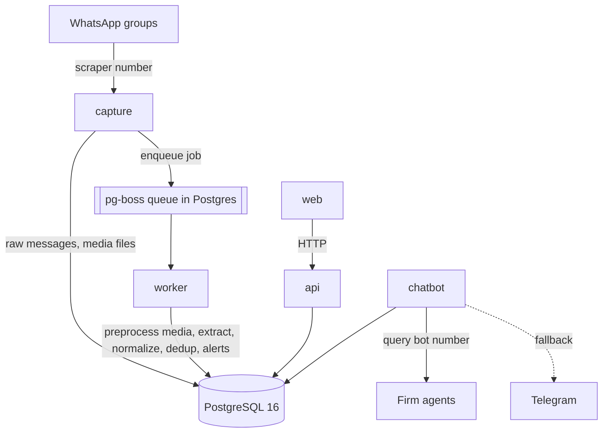
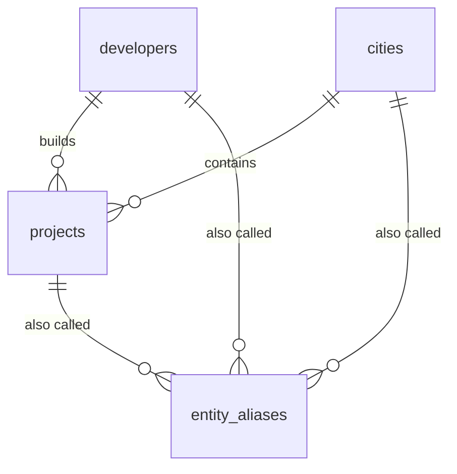

# Real Estate Bot: Project Manual

This is the full technical manual. Together with [README.md](README.md), someone who has never seen the project should be able to understand it, set it up from zero, run it and fix it. Each chapter says what exists **now**. Parts that later phases will build are marked _(Phase N)_.

Reference material that could drift from the code is generated, not hand-written:

- [docs/generated/env.md](docs/generated/env.md): environment variables (from `packages/config/src/env.ts`)
- [docs/generated/database.md](docs/generated/database.md): tables, columns, indexes and entity diagram (from `packages/db/src/schema/`)
- API reference _(Phase 5, generated from Fastify route schemas)_

Regenerate them with `pnpm run docs`. CI runs `pnpm docs:check` and fails if they are out of date.

## Build status

| Phase | Scope                                                         | Status      |
| ----- | ------------------------------------------------------------- | ----------- |
| 0     | Foundation: monorepo, config, logging, Docker, database, seed | **Done**    |
| 1     | Capture (Baileys, raw messages, media)                        | Not started |
| 2     | Text extraction and eval harness                              | Not started |
| 3     | Media extraction (vision, PDF, speech-to-text)                | Not started |
| 4     | Dedup, price history, lifecycle                               | Not started |
| 5     | API and owner admin                                           | Not started |
| 6     | Multi-tenant firm dashboard                                   | Not started |
| 7     | Chat bots and alerts                                          | Not started |
| 8     | Hardening and deploy                                          | Not started |

---

## 1. Overview and glossary

Hassan, a broker, runs this as a service. A bot reads Egyptian developer and broker WhatsApp groups and turns every listing into structured, deduplicated records that stay current. Brokerage firms pay for access to that shared listing pool. They get fresher and cleaner data than they would by reading the groups themselves.

**Users.** The **owner** (Hassan) controls everything. Each **firm** has a **firm admin** who manages the firm's users, and **agents** who search, save searches, get alerts and export.

| Term                            | Meaning in the code                                                                                                                            |
| ------------------------------- | ---------------------------------------------------------------------------------------------------------------------------------------------- |
| **Entity**                      | A canonical city, developer or project: one official row per real-world thing (`cities`, `developers`, `projects`).                            |
| **Alias**                       | Another spelling of an entity, in any script (`entity_aliases`). "التجمع", "5th Settlement" and "Tagamoa" are aliases of the city _New Cairo_. |
| **Normalized name**             | The output of `normalizeName()`: lowercase, unified Arabic letters, no diacritics or punctuation. Aliases are matched on this.                 |
| **Seed**                        | The starter list of entities and aliases in `packages/db/seed/`, loaded by `pnpm db:seed`.                                                     |
| **Migration**                   | A numbered SQL file in `packages/db/migrations/` that changes the database structure.                                                          |
| **Unit / offering** _(Phase 2)_ | One row in `units`: a unit type with area and price range in one project, or a single named unit when a Unit Code is given.                    |
| **Source** _(Phase 4)_          | A WhatsApp message that mentioned a unit. One unit can have many sources.                                                                      |
| **Run** _(Phase 2)_             | One LLM extraction attempt on one message (`extraction_runs`), with its prompt version and model.                                              |
| **Prompt version** _(Phase 2)_  | The version string of the extraction prompt, recorded on every run so results can be compared.                                                 |
| **Firm** _(Phase 6)_            | A paying brokerage. Owns its users, saved searches, alerts and notes. Listings are shared.                                                     |
| **Saved search** _(Phase 6)_    | A stored filter that can trigger alerts.                                                                                                       |

## 2. Architecture



| Service | Responsibility                                                                                                 | Must never                         |
| ------- | -------------------------------------------------------------------------------------------------------------- | ---------------------------------- |
| capture | Stay connected to WhatsApp, save every message from watched groups with media and reply context, enqueue a job | Call an LLM or do heavy processing |
| worker  | Run all pipeline jobs with retries, backoff and rate limits                                                    | Talk to WhatsApp directly          |
| api     | Auth, firm scoping, search, review, admin actions, exports                                                     | Contain extraction logic           |
| web     | Firm dashboard and owner admin UI                                                                              | Query the database directly        |
| chatbot | Answer listing queries and deliver alerts, Telegram as fallback                                                | Use the scraper's WhatsApp number  |

**Why these choices**

- **Capture and worker are separate.** Capture only saves; it never waits for a model. If a model is slow, down or out of credit, messages still pile up safely in Postgres and are processed later. Old messages can be reprocessed after any prompt or model change.
- **The queue is in Postgres (pg-boss).** No Redis to run, back up or monitor. Jobs, retries and schedules live next to the data and are covered by the same backup.
- **Baileys** talks to WhatsApp over a WebSocket without a headless browser, so it is lighter and easier to deploy than whatsapp-web.js. It is unofficial, so the scraper and query bot use separate numbers and Telegram is the fallback.
- **One shared Zod schema** _(Phase 2)_ defines the listing fields once; database types, LLM JSON schema and API types come from it.
- **The LLM reads; code decides.** The model only pulls raw values out of messy text. All arithmetic, entity matching, currency handling, confidence scoring and merge decisions are deterministic code with tests.
- **Node runs TypeScript directly.** Node 24 strips type annotations at load time, so there is no compile step for the Node services: the code that runs is the code you read. `tsc` is used only as a type checker. The cost: TypeScript-only runtime features (`enum`, `namespace`) are not allowed, which `erasableSyntaxOnly` enforces. Use `as const` objects or Zod enums instead.
- **One Docker image for all services.** Each service is the same image with a different command, so they always share exact code and dependency versions.

**Phase 0 runtime behaviour.** Every Node service starts through `runService` (`packages/runtime`): load config, then logger, then database pool, then `/health`. On SIGTERM it shuts down cleanly. The API is the exception: it has its own Fastify server and serves `/health` on `API_PORT`.

## 3. Repository map

```
realestate-bot/
  apps/
    capture/   src/main.ts: skeleton service                          (Phase 1 fills in)
    worker/    src/main.ts: skeleton service                          (Phases 1-4)
    api/       src/app.ts (Fastify routes), src/main.ts (startup)       (Phases 5-6)
    web/       Vite + React placeholder                                 (Phases 5-6)
    chatbot/   src/main.ts: skeleton service                          (Phase 7)
  packages/
    config/    env schema (Zod) and loadConfig()
    db/        Drizzle schema, migrations, client, migrate + seed scripts, seed data
    normalize/ normalizeName() and digit conversion
    runtime/   logger, health server, runService()
  scripts/docs.ts           generates docs/generated/* and .env.example
  docs/generated/           generated reference docs (do not edit)
  docker-compose.yml        Postgres + migrate step + five services
  Dockerfile                one image for every service
  .github/workflows/ci.yml  lint, format, types, tests (with real Postgres), docs check, web build
```

| Package          | Owns                                                | Main files                                              | Used by                            |
| ---------------- | --------------------------------------------------- | ------------------------------------------------------- | ---------------------------------- |
| `@reb/config`    | Environment variables: schema, defaults, validation | `src/env.ts`, `src/load.ts`                             | db, runtime, api, scripts          |
| `@reb/normalize` | Deterministic text normalization                    | `src/text.ts`                                           | db (seed) and, later, the pipeline |
| `@reb/db`        | Tables, migrations, pool, seed                      | `src/schema/*`, `migrations/*`, `src/seed.ts`, `seed/*` | runtime, api, scripts              |
| `@reb/runtime`   | Logging, health checks, service lifecycle           | `src/logger.ts`, `src/health.ts`, `src/service.ts`      | all Node apps                      |

Packages planned for later phases and not created yet: `schema` and `llm` (Phase 2), `media` (Phase 3), `dedup` (Phase 4), `chat-core` (Phase 7), and the `eval/` folder (Phase 2).

**Dependency direction:** `apps → runtime → db → (config, normalize)`. Packages never import from apps.

**Library versions** (checked 2026-10-25):

| Library                               | Version                          | Note                                                   |
| ------------------------------------- | -------------------------------- | ------------------------------------------------------ |
| Node.js                               | 24 LTS (Docker), ≥ 22.18 locally | 22.18+ runs TypeScript without flags                   |
| pnpm                                  | 12.15.0                          |                                                        |
| TypeScript                            | 6.0.3                            | 7.0 exists but typescript-eslint supports < 6.1        |
| drizzle-orm / drizzle-kit             | 0.45.4 / 0.31.11                 | latest stable; 1.0 is still beta                       |
| pg (node-postgres)                    | 8.23.1                           |                                                        |
| zod                                   | 4.6.7                            |                                                        |
| pino                                  | 10.4.0                           |                                                        |
| fastify                               | 5.12.7                           |                                                        |
| vite / react                          | 8.3.5 / 19.3.1                   |                                                        |
| vitest                                | 5.0.5                            |                                                        |
| eslint / typescript-eslint / prettier | 10.13.0 / 8.72.0 / 3.9.10        |                                                        |
| pg-boss                               | 12.38.0                          | Phase 1                                                |
| baileys                               | 7.0.0-rc14                       | Phase 1. Still a release candidate; see Phase 1 notes. |
| grammY                                | 1.46.0                           | Phase 7                                                |
| better-auth                           | 1.7.12                           | Phase 5                                                |
| exceljs                               | 4.4.0                            | Phase 2                                                |

## 4. Data model

The full generated reference, with every column and an entity diagram, is in [docs/generated/database.md](docs/generated/database.md).

**What exists now (Phase 0): canonical entities.**



- `cities`, `developers`: an English name (unique, used in exports) and an Arabic name.
- `projects`: belong to one developer and one city. The English name is unique per developer.
- `entity_aliases`: every known spelling. Exactly one of `city_id`, `developer_id`, `project_id` is set (a CHECK constraint enforces it). The same normalized spelling cannot point at the same entity twice, but it may name a city _and_ a project (for example "Madinaty").
- Deleting a city or developer that still has projects is refused (`ON DELETE RESTRICT`). Deleting an entity deletes its aliases (`ON DELETE CASCADE`).
- IDs are small integers (identity columns) because these tables are small and you will read and type these IDs by hand.

**How names are matched.** Both the stored alias and the incoming text go through `normalizeName()` (chapter 6), then:

1. exact match on `alias_normalized` (index), and if nothing is found
2. fuzzy match with pg_trgm: `alias_normalized % $1 ORDER BY similarity(...) DESC` (GIN trigram index).

The matching function itself arrives with extraction in Phase 2. The table and indexes are ready.

**Tables added by later phases:** `wa_groups`, `messages`, `media_files` (Phase 1); `units`, `extraction_runs` (Phase 2); `unit_prices`, `unit_sources` (Phase 4); `review_corrections`, `audit_log` (Phase 5); `firms`, `users`, `chat_identities`, `saved_searches`, `firm_notes`, `usage_events` (Phase 6); `alert_deliveries` (Phase 7). Each arrives as its own migration in the phase that uses it.

**Primary Units template mapping** _(Phase 2)_: the 26 template columns, their database columns and export rules will be generated here from `packages/schema`.

**Money** _(Phase 2)_ is stored as integer piastres with an explicit currency column. Conversion happens only at query time.

## 5. Pipeline _(Phases 1 to 4)_

Not built yet. Each step will be its own pg-boss job type (capture → preprocess → assemble context → classify → extract → validate/normalize → dedup/merge → lifecycle → alerts), each idempotent, with retries, backoff and a reprocessing CLI. This chapter will document every job's input, output, retry policy and failure states.

## 6. Extraction

**Normalization rules in place now** (`packages/normalize`):

| Rule                                             | Example                                  |
| ------------------------------------------------ | ---------------------------------------- |
| Lowercase, Unicode NFKC                          | `ＳＯＤＩＣ West` → `sodic west`         |
| Arabic-Indic and Persian digits to ASCII         | `٦ أكتوبر` → `6 اكتوبر`                  |
| Remove diacritics (tashkeel) and tatweel         | `التجمّـع` → `التجمع`                    |
| `أ إ آ ٱ` → `ا`                                  | `إعمار` → `اعمار`                        |
| `ى` → `ي`, `ة` → `ه`, `ؤ` → `و`, `ئ` → `ي`       | `العاصمة الإدارية` → `العاصمه الاداريه`  |
| Non-letters and non-digits become a single space | `Il-Monte  Galala!!` → `il monte galala` |

These only erase differences that never change meaning. Riskier matching (typos, dropped "ال") is done by trigram similarity, where it can be tuned and reviewed.

_(Phase 2)_ Prompts and versions, model fallback chain, number and unit parsing, confidence. _(Phase 4)_ Dedup algorithm with worked examples. _(Phase 3)_ Cost per message.

## 7. Interfaces

**API routes (Phase 0)**

| Method | Path      | Response                                                                                                    |
| ------ | --------- | ----------------------------------------------------------------------------------------------------------- |
| GET    | `/health` | `200 {"status":"ok","service":"api","checks":{"database":"ok"}}`, or `503` with the failing check's message |

Capture, worker and chatbot each serve the same `GET /health` on `HEALTH_PORT` (8080 inside Docker; not published to the host).

**Web (Phase 0):** a placeholder page at http://localhost:4173.

_(Phase 5)_ Owner admin pages. _(Phase 6)_ Firm dashboard. _(Phase 7)_ Chat bot commands with sample Arabic and English queries.

## 8. Configuration

Every variable, with purpose, whether it is required, its default and an example: **[docs/generated/env.md](docs/generated/env.md)**. `.env.example` is generated from the same source.

How it works:

- Services read variables once at startup through `loadConfig()` (`packages/config`). A missing or invalid value stops the service with a message naming the variable.
- When running on your machine, `pnpm db:migrate`, `pnpm db:seed` and `pnpm dev:*` load the root `.env` automatically (Node's `--env-file-if-exists`).
- Inside Docker Compose, `DATABASE_URL` is built from `POSTGRES_USER`, `POSTGRES_PASSWORD` and `POSTGRES_DB` with host `postgres`; the `DATABASE_URL` in `.env` is for running tools on your own machine (host `localhost`).
- `.env` is never committed (`.gitignore`). Secrets only live in environment variables.

## 9. Setting up from zero

Steps marked _(Phase N)_ are not possible yet.

**1. Prerequisites.** A Linux machine or Mac with:

- Docker Engine with the Compose plugin (`docker compose version` works)
- Git
- For development only: Node.js 24 (`nvm install 24`) and pnpm 12 (`npm install -g pnpm@12.15.0`)

**2. Two dedicated WhatsApp numbers** _(needed from Phase 1)_: one for the scraper, one for the query bot. Never Hassan's personal number.

**3. Clone**

```sh
git clone <repo-url> realestate-bot
cd realestate-bot
```

**4. Create `.env`**

```sh
cp .env.example .env
```

Edit `.env`: set `POSTGRES_PASSWORD` to a long random value (`openssl rand -hex 24` makes one), and put the same password in `DATABASE_URL`. The password is only applied the first time the database volume is created (see runbook "Database password rejected").

**5. Start everything**

```sh
docker compose up -d --build
```

This builds one image, starts Postgres, runs the `migrate` step (migrations, then seed), then starts capture, worker, api, chatbot and web. The first build takes a few minutes.

**6. Confirm it works**

```sh
docker compose ps
```

Expected: `postgres`, `capture`, `worker`, `api`, `chatbot`, `web` show `Up ... (healthy)` within about a minute; `migrate` shows `Exited (0)`.

```sh
docker compose logs migrate
# Migrations applied.
# Seed loaded: 11 cities, 20 developers, 57 projects, 349 new aliases.
curl http://localhost:3000/health
# {"status":"ok","service":"api","checks":{"database":"ok"}}
```

To look at the data:

```sh
docker compose exec postgres psql -U reb -d reb -c "select name_en, name_ar from cities"
```

**7. Development setup (optional)**

```sh
pnpm install
pnpm check        # lint, formatting, type check, tests, generated-docs check
```

To include the database integration tests, point them at the running Postgres (the user must be allowed to create databases; the Compose user is):

```sh
TEST_DATABASE_URL=postgres://reb:<password>@localhost:5432/reb pnpm test
```

**Later steps:** create the owner account _(Phase 5)_ · pair the scraper number by QR _(Phase 5; Phase 1 via terminal)_ · choose groups _(Phase 5)_ · pair the query bot and create the Telegram bot _(Phase 7)_ · confirm a message flows end to end _(Phase 2)_ · create the first firm _(Phase 6)_ · run the first eval _(Phase 2)_.

## 10. Daily operations

**Adding or correcting entities and aliases (until the admin UI in Phase 5):** edit `packages/db/seed/*.ts`, run `pnpm test` to validate, then `pnpm db:seed` (or `docker compose up -d --build`, which re-runs the seed). The seed only adds and updates; it never deletes.

**Checking the system:** `docker compose ps` (all healthy?) and `docker compose logs -f --since 10m <service>`.

_(Phase 5)_ Review queue, groups, stats. _(Phase 6)_ Onboarding and offboarding firms, exports.

## 11. Runbooks

**A service shows `unhealthy` or keeps restarting**

- Check: `docker compose logs --tail 50 <service>`.
- `ConfigError: Invalid environment configuration` followed by a variable name means a missing or invalid variable. Fix `.env`, then run `docker compose up -d`.
- `database: ...` in the health output means Postgres is unreachable. See the next runbook.

**Postgres is down or restarting**

- Services keep running and report `503` on `/health` while it is down (they log `Idle database connection lost; will reconnect`). They recover by themselves when it is back; nothing needs restarting.
- Check: `docker compose ps postgres` and `docker compose logs postgres`.

**`migrate` exited with an error, so the apps never started**

- Check: `docker compose logs migrate`.
- `Seed data has N problem(s)` followed by a list: fix the listed entries in `packages/db/seed/`, run `pnpm test`, then `docker compose up -d --build`.
- An SQL error from a migration: do not edit the database by hand. Fix the migration in a new commit (or restore from backup in production) and rerun.

**Database password rejected (`password authentication failed for user "reb"`)**

- Cause: `POSTGRES_PASSWORD` was changed after the database volume was first created. Postgres only reads it the first time.
- Fix on a dev machine with no data worth keeping: `docker compose down -v` (deletes the database) and `docker compose up -d`. In production, change the password inside Postgres (`ALTER USER reb PASSWORD '...'`) instead.

**Port already in use (`Bind for 127.0.0.1:5432 failed: port is already allocated`)**

- Another Postgres (or app) is using the port. Stop it, or change the left-hand port in `docker-compose.yml` (for example `127.0.0.1:5433:5432`) and the port in `.env`'s `DATABASE_URL`.

**Upgrading the app and running migrations**

```sh
git pull
docker compose up -d --build   # the migrate step applies new migrations before apps restart
```

_(Later phases)_ WhatsApp disconnected, number banned, model errors, cost spike, job backlog, failed jobs, disk full of media, restoring a backup, rotating secrets.

## 12. Evaluation _(Phase 2)_

The eval set (`eval/cases`), `pnpm eval`, the report format and the approval rule for prompt or model changes (a drop of more than 2 points on a key field needs Hassan's approval) arrive in Phase 2.

## 13. Testing

```sh
pnpm test                                     # all unit tests (Vitest)
pnpm vitest run packages/normalize            # one package
pnpm vitest --watch                           # re-run on save
TEST_DATABASE_URL=postgres://reb:<pw>@localhost:5432/reb pnpm test   # plus database integration tests
```

| Suite                                               | Covers                                                                                                               | Needs                                                                                           |
| --------------------------------------------------- | -------------------------------------------------------------------------------------------------------------------- | ----------------------------------------------------------------------------------------------- |
| `packages/config/test`                              | defaults, coercion, readable errors                                                                                  | nothing                                                                                         |
| `packages/normalize/test`                           | every normalization rule, Arabic and mixed-script                                                                    | nothing                                                                                         |
| `packages/db/test/seed-data.test.ts`                | seed data has no duplicates, bad references or ambiguous aliases                                                     | nothing                                                                                         |
| `packages/db/test/client.test.ts`                   | a lost connection does not crash the process                                                                         | nothing                                                                                         |
| `packages/db/test/migrate-seed.integration.test.ts` | migrations on a clean database, rerun is a no-op, seed twice adds nothing, alias lookup, trigram lookup, constraints | `TEST_DATABASE_URL`. Creates and drops a throwaway `reb_test_*` database. Skipped when not set. |
| `packages/runtime/test`                             | health server 200/503/404, log redaction                                                                             | nothing                                                                                         |
| `apps/api/test`                                     | `/health` 200 and 503 (database mocked)                                                                              | nothing                                                                                         |

No test calls WhatsApp, Telegram or a paid API. _(Phase 2)_ LLM fixtures will be recorded responses replayed offline.

CI (`.github/workflows/ci.yml`) runs lint, format check, type check, all tests against a real Postgres service, the generated-docs check and the web build on every push and pull request.

## 14. Deployment _(Phase 8)_

VPS setup, domain and Caddy (HTTPS), daily off-server backups with a tested restore, monitoring and owner alerts. Until then, `docker compose up -d --build` on any Docker host runs the system; ports are bound to `127.0.0.1` only, so nothing is exposed to the internet.

## 15. Security and privacy

**Now:**

- Secrets only in `.env` / environment variables; `.env` is git-ignored. Generated docs mark secret variables.
- Postgres, API and web ports bind to `127.0.0.1` only.
- Containers run as the unprivileged `node` user.
- The logger redacts `phone`, `phoneNumber`, `senderName`, `senderPhone`, `pushName`, `participant`, `password`, `token` and `authorization` fields at the top level and one level deep.

_(Phase 1)_ Sender identity stored only as a salted hash. _(Phase 2)_ Names and numbers stripped before anything reaches a model. _(Phase 6)_ Firm isolation with tests on every route, and the audit log. **Law 151 of 2020:** sender names and phone numbers are personal data; Hassan should get legal advice before charging firms (open decision).

## 16. Troubleshooting FAQ

**`error while interpolating services.api.environment.DATABASE_URL: required variable POSTGRES_PASSWORD is missing a value: Set POSTGRES_PASSWORD in .env`**
There is no `.env`, or it has no `POSTGRES_PASSWORD`. Run `cp .env.example .env` and set it.

**`Invalid environment configuration: ✖ Invalid input: expected string, received undefined → at DATABASE_URL`**
The service can't see `DATABASE_URL`. `pnpm db:migrate`, `pnpm db:seed` and `pnpm dev:*` read the `.env` in the repository root automatically, so check it exists and has `DATABASE_URL`. Other commands (such as `pnpm test`) don't read `.env`.

**`pnpm docs` prints `error: the following required arguments were not provided: <PACKAGE>`**
`pnpm docs` is a built-in pnpm command (it opens a package's homepage). Use `pnpm run docs`.

**`TypeError [ERR_UNKNOWN_FILE_EXTENSION]: Unknown file extension ".ts"`**
Your Node is older than 22.18 and can't run TypeScript directly. Install Node 24 (`nvm install 24`). `pnpm install` also refuses to run on an old Node (`engine-strict`).

**`ERR_PNPM_IGNORED_BUILDS` during `pnpm install`**
A new dependency needs an install script. If you trust it, add it under `allowBuilds` in `pnpm-workspace.yaml`.

**`toomanyrequests` / `429 Too Many Requests` while pulling images**
Docker Hub's anonymous pull limit. Run `docker login`, or wait and retry.

## 17. Decision log

| Date       | Decision                                                                                                                                                                                                                                                                                                                                                                                                                                                                                      | Reason                                                                                                                                                                                                                              | Alternatives considered                                    |
| ---------- | --------------------------------------------------------------------------------------------------------------------------------------------------------------------------------------------------------------------------------------------------------------------------------------------------------------------------------------------------------------------------------------------------------------------------------------------------------------------------------------------- | ----------------------------------------------------------------------------------------------------------------------------------------------------------------------------------------------------------------------------------- | ---------------------------------------------------------- |
| 2026-10-25 | TypeScript **6.0.3**, not 7.0                                                                                                                                                                                                                                                                                                                                                                                                                                                                 | typescript-eslint 8.72 supports TypeScript < 6.1 only. Revisit when it supports 7.                                                                                                                                                  | TS 7 without type-aware lint rules                         |
| 2026-10-25 | Node services run **.ts directly** (Node type stripping); no build step except the web app                                                                                                                                                                                                                                                                                                                                                                                                    | Code that runs is the code you read; no build output to keep in sync. Requires `erasableSyntaxOnly` (no `enum`/`namespace`).                                                                                                        | tsc build to `dist/`; tsup/esbuild bundles; tsx at runtime |
| 2026-10-25 | **Node 24 LTS** in Docker; Node ≥ 22.18 allowed locally                                                                                                                                                                                                                                                                                                                                                                                                                                       | 24 is the current LTS; 22.18+ also runs TypeScript unflagged                                                                                                                                                                        | Node 22 everywhere                                         |
| 2026-10-25 | **pnpm 12**; the docs script is run as **`pnpm run docs`**                                                                                                                                                                                                                                                                                                                                                                                                                                    | Latest pnpm. Every pnpm version has a built-in `pnpm docs` command that takes precedence over a script of the same name. The script keeps the name `docs` as the plan asks; only the `run` is added. `pnpm docs:check` works as-is. | Renaming the script (e.g. `gen:docs`)                      |
| 2026-10-25 | Added **`packages/runtime`** (logger, health server, service lifecycle)                                                                                                                                                                                                                                                                                                                                                                                                                       | Not in the plan's layout, but four apps need identical startup, logging and health code; apps must not hold logic.                                                                                                                  | Copying the code into each app; putting it in `config`     |
| 2026-10-25 | **First migration holds only the entity tables** (plus pg_trgm); each later table arrives as a migration in the phase that uses it                                                                                                                                                                                                                                                                                                                                                            | The seed needs only entities. Tables like `units` depend on enums still awaiting Hassan's answers (section 14 of the plan); creating them now would mean guessing and migrating again.                                              | Creating the whole data model in Phase 0                   |
| 2026-10-25 | **Aliases use three nullable foreign keys** + CHECK exactly-one, not `entity_type + entity_id`                                                                                                                                                                                                                                                                                                                                                                                                | Postgres enforces that an alias always points at an existing entity, and cascades deletes                                                                                                                                           | Polymorphic type/id pair; one alias table per entity type  |
| 2026-10-25 | **Integer identity IDs** for entity tables                                                                                                                                                                                                                                                                                                                                                                                                                                                    | Small tables whose IDs Hassan will read and type                                                                                                                                                                                    | UUIDs                                                      |
| 2026-10-25 | **node-postgres (`pg`)** as the database driver                                                                                                                                                                                                                                                                                                                                                                                                                                               | pg-boss uses `pg`; one driver for the whole system                                                                                                                                                                                  | postgres.js                                                |
| 2026-10-25 | **Drizzle 0.45 / drizzle-kit 0.31** (stable)                                                                                                                                                                                                                                                                                                                                                                                                                                                  | Drizzle 1.0 is still in beta                                                                                                                                                                                                        | 1.0 beta                                                   |
| 2026-10-25 | **One Docker image** for all services                                                                                                                                                                                                                                                                                                                                                                                                                                                         | Identical code and dependencies everywhere; one build                                                                                                                                                                               | One image per service                                      |
| 2026-10-25 | Phase 0 **web is served by `vite preview`**                                                                                                                                                                                                                                                                                                                                                                                                                                                   | Enough to prove the build and health check; Caddy (Phase 8) will serve the static files over HTTPS                                                                                                                                  | nginx container (an extra service not in the plan)         |
| 2026-10-25 | Seed areas reviewed by Hassan: **Katameya, Galala City, El Gouna, Ras El Hekma, New Alamein and Sidi Abdel Rahman are their own cities**; Madinaty is both a city and a project; Sarai stays in Mostakbal City; short aliases (Kai, Taj, D5, Noor, MV) are kept. North Coast projects whose exact area is unknown (June, Caesar, Silversands, Seashore, Fouka Bay, D-Bay, Seazen, La Vista Bay, Jefaira, Azha North Coast) stay under North Coast until real messages show where they belong. | Firms want to filter by these areas; exact matching on the whole name keeps short aliases low-risk, and the review queue catches mistakes.                                                                                          | Treating sub-areas as aliases of a larger city             |
| 2026-10-25 | API reference generation **deferred to Phase 5**                                                                                                                                                                                                                                                                                                                                                                                                                                              | Phase 0 has a single `/health` route; generation will use Fastify route schemas once real routes exist                                                                                                                              | Generating from `/health` only                             |
