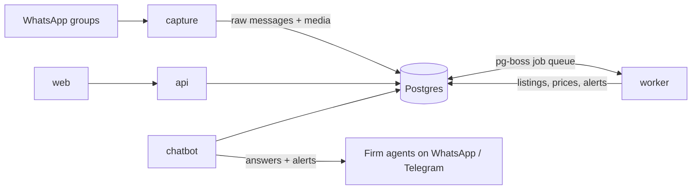

# Real Estate Bot

A service that reads Egyptian developer and broker WhatsApp groups, turns every listing (text, images, PDFs) into clean, deduplicated records, and sells access to that listing database to brokerage firms.

> **Status: Phases 0-5 built.** Capture stores messages; the worker reads text, flyers, PDFs and Excel price lists (Gemini, with Groq and OpenRouter as text fallbacks) into the Primary Units template, merges reposts into one unit, keeps price history and handles price updates and sold notices. The owner's admin console (Phase 5) pairs the number, chooses groups, reviews flagged units side by side with the original flyer, manages names and spellings, shows stats and failed jobs, and exports Excel, all from the browser. Phase 6 (firm dashboard) is next. Live runs wait for the scraper number and real test messages. See [PROJECT.md](PROJECT.md#build-status).

## Architecture in one screen



| Service   | Job                                                          |
| --------- | ------------------------------------------------------------ |
| `capture` | Saves every message from watched groups. Never calls an LLM. |
| `worker`  | Runs the pipeline: media → extraction → dedup → alerts.      |
| `api`     | Auth, firm scoping, search, review, admin, exports.          |
| `web`     | Owner admin console now; firm dashboard in Phase 6 (React).  |
| `chatbot` | WhatsApp query bot on its own number, Telegram as backup.    |

Business logic lives in `packages/`; `apps/` only connect it to the outside world.

## Quick start

You need Docker with Compose, plus Node.js 24 and pnpm 12 for development.

```sh
git clone <repo-url> realestate-bot && cd realestate-bot
cp .env.example .env            # set POSTGRES_PASSWORD (also in DATABASE_URL), SENDER_HASH_SALT and AUTH_SECRET
docker compose up -d --build    # Postgres, migrations + seed, and all five services
docker compose ps               # every service should say "healthy"; migrate says "Exited (0)"
curl http://localhost:3000/health
```

Create your admin login, then open http://localhost:4173 and sign in:

```sh
docker compose exec -it api node apps/api/src/create-owner.ts --email you@example.com --name Hassan
```

From there: **WhatsApp** (scan the QR code with the scraper phone), **Groups** (tick the groups to watch), **Review** (check flagged listings).

For development without Docker for the apps:

```sh
pnpm install
docker compose up -d postgres
pnpm db:migrate && pnpm db:seed
pnpm dev:api                    # or dev:capture, dev:worker, dev:chatbot, dev:web
pnpm check                      # lint, format, types, tests, generated docs
```

## Documentation

- [PITCH.md](PITCH.md): plain-language overview for investors and buyers (updated every phase)
- [PROJECT.md](PROJECT.md): the full technical manual (architecture, data model, setup from zero, operations, runbooks, decision log)
- [docs/generated/env.md](docs/generated/env.md): every environment variable
- [docs/generated/database.md](docs/generated/database.md): every table and column
- [docs/generated/template.md](docs/generated/template.md): the 26 export columns and their rules
- [docs/generated/api.md](docs/generated/api.md): every API route
- [eval/README.md](eval/README.md): the accuracy test set
- Each package has its own README explaining what it does and why
