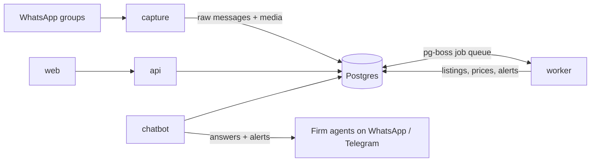

# Real Estate Bot

A service that reads Egyptian developer and broker WhatsApp groups, turns every listing (text, images, PDFs, voice notes) into clean, deduplicated records, and sells access to that listing database to brokerage firms.

> **Status: Phase 2 (text extraction) built.** Capture stores messages; the worker classifies and extracts text listings with Cerebras into the Primary Units template; `pnpm eval` measures accuracy. Live runs wait for the scraper number, a Cerebras API key and real test messages. See [PROJECT.md](PROJECT.md#build-status).

## Architecture in one screen



| Service   | Job                                                          |
| --------- | ------------------------------------------------------------ |
| `capture` | Saves every message from watched groups. Never calls an LLM. |
| `worker`  | Runs the pipeline: media → extraction → dedup → alerts.      |
| `api`     | Auth, firm scoping, search, review, admin, exports.          |
| `web`     | Firm dashboard and owner admin (React).                      |
| `chatbot` | WhatsApp query bot on its own number, Telegram as backup.    |

Business logic lives in `packages/`; `apps/` only connect it to the outside world.

## Quick start

You need Docker with Compose, plus Node.js 24 and pnpm 12 for development.

```sh
git clone <repo-url> realestate-bot && cd realestate-bot
cp .env.example .env            # set POSTGRES_PASSWORD (also in DATABASE_URL) and SENDER_HASH_SALT
docker compose up -d --build    # Postgres, migrations + seed, and all five services
docker compose ps               # every service should say "healthy"; migrate says "Exited (0)"
curl http://localhost:3000/health
```

Open http://localhost:4173 for the (placeholder) dashboard.

For development without Docker for the apps:

```sh
pnpm install
docker compose up -d postgres
pnpm db:migrate && pnpm db:seed
pnpm dev:api                    # or dev:capture, dev:worker, dev:chatbot, dev:web
pnpm check                      # lint, format, types, tests, generated docs
```

## Documentation

- [PROJECT.md](PROJECT.md): the full technical manual (architecture, data model, setup from zero, operations, runbooks, decision log)
- [docs/generated/env.md](docs/generated/env.md): every environment variable
- [docs/generated/database.md](docs/generated/database.md): every table and column
- [docs/generated/template.md](docs/generated/template.md): the 26 export columns and their rules
- [eval/README.md](eval/README.md): the accuracy test set
- Each package has its own README explaining what it does and why
