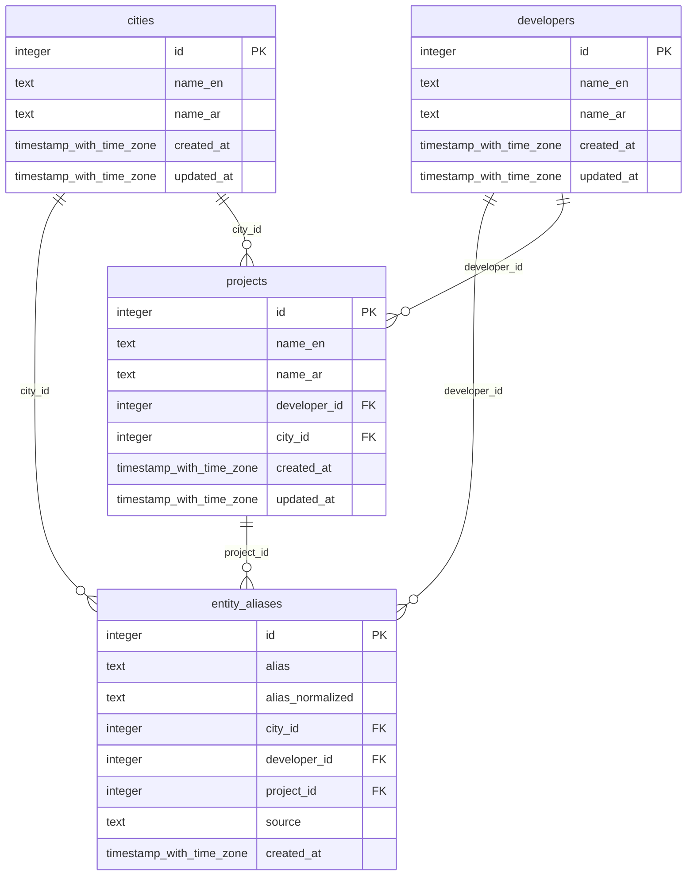

# Database reference

<!-- Generated by `pnpm run docs`. Do not edit by hand. Sources: packages/db/src/schema/ -->

## `cities`

Canonical cities and areas (New Cairo, Sheikh Zayed, North Coast, ...).

| Column | Type | Nullable | Keys | Meaning |
| --- | --- | --- | --- | --- |
| `id` | integer | no | primary key | Identity primary key. |
| `name_en` | text | no | unique | Official English name. Used in exports. Unique. |
| `name_ar` | text | no |  | Official Arabic name. |
| `created_at` | timestamp with time zone | no |  | When the row was created. |
| `updated_at` | timestamp with time zone | no |  | When the row was last changed. |

## `developers`

Canonical real estate developers (Emaar Misr, SODIC, Palm Hills, ...).

| Column | Type | Nullable | Keys | Meaning |
| --- | --- | --- | --- | --- |
| `id` | integer | no | primary key | Identity primary key. |
| `name_en` | text | no | unique | Official English name. Used in exports. Unique. |
| `name_ar` | text | no |  | Official Arabic name. |
| `created_at` | timestamp with time zone | no |  | When the row was created. |
| `updated_at` | timestamp with time zone | no |  | When the row was last changed. |

## `entity_aliases`

Alternate spellings (Arabic, English, abbreviations) mapped to one city, developer or project. Exactly one of the three entity columns is set.

| Column | Type | Nullable | Keys | Meaning |
| --- | --- | --- | --- | --- |
| `id` | integer | no | primary key | Identity primary key. |
| `alias` | text | no |  | The spelling as written, kept for display and review. |
| `alias_normalized` | text | no |  | The spelling after normalizeName(): lowercase, unified Arabic letters, no diacritics or punctuation. Matching uses this column. |
| `city_id` | integer | yes | → cities.id | Set when the alias names a city. |
| `developer_id` | integer | yes | → developers.id | Set when the alias names a developer. |
| `project_id` | integer | yes | → projects.id | Set when the alias names a project. |
| `source` | text | no |  | Where the alias came from: `seed` (seed data), `manual` (added by the owner), `review` (learned from a review-queue correction). |
| `created_at` | timestamp with time zone | no |  | When the alias was added. |

**Indexes and constraints**

- Unique index `entity_aliases_city_alias_key` on (city_id, alias_normalized)
- Unique index `entity_aliases_developer_alias_key` on (developer_id, alias_normalized)
- Unique index `entity_aliases_project_alias_key` on (project_id, alias_normalized)
- Index `entity_aliases_alias_trgm_idx` on (expression) using gin
- Check `entity_aliases_exactly_one_entity`

## `projects`

Canonical projects (compounds). Each belongs to one developer and one city.

| Column | Type | Nullable | Keys | Meaning |
| --- | --- | --- | --- | --- |
| `id` | integer | no | primary key | Identity primary key. |
| `name_en` | text | no |  | Official English name. Used in exports. Unique per developer. |
| `name_ar` | text | no |  | Official Arabic name. |
| `developer_id` | integer | no | → developers.id | The developer that builds this project. |
| `city_id` | integer | no | → cities.id | The city or area the project is in. |
| `created_at` | timestamp with time zone | no |  | When the row was created. |
| `updated_at` | timestamp with time zone | no |  | When the row was last changed. |

**Indexes and constraints**

- Unique index `projects_developer_name_en_key` on (developer_id, name_en)
- Index `projects_city_id_idx` on (city_id)
